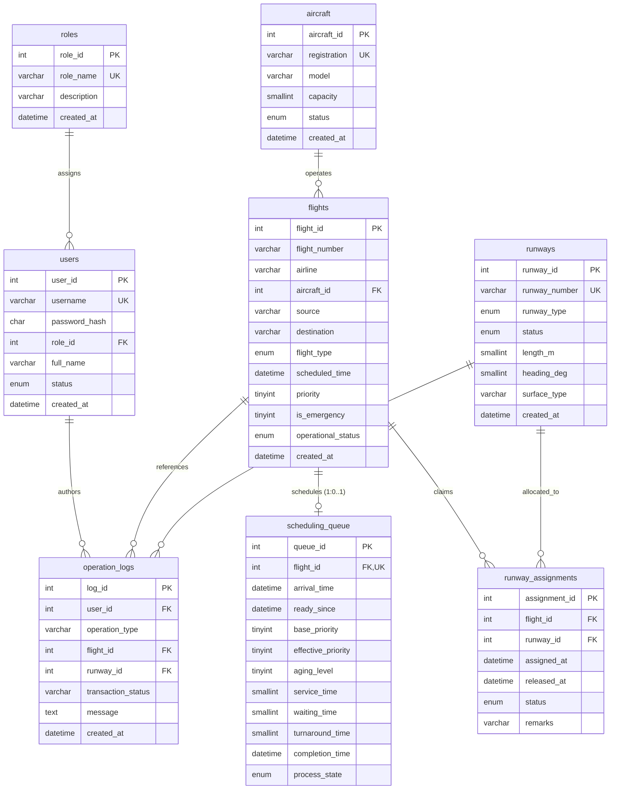

# Database Schema Specification — SmartATC

## 1. Overview of the 8-Table Schema

The Smart Air Traffic Control Management System (`SmartATC`) database (`smartatc`) consists of **eight normalized relational tables** managed by the **MySQL InnoDB** storage engine using `utf8mb4` encoding and `utf8mb4_unicode_ci` collation.

---

## 2. Table Specifications

### 2.1 Table: `roles`
- **Purpose:** Stores system user authorization roles.
- **Engine / Collation:** InnoDB / `utf8mb4_unicode_ci`
- **Primary Key:** `role_id`

| Column | Data Type | Null | Default | Description |
|---|---|---|---|---|
| `role_id` | `INT` | NO | `AUTO_INCREMENT` | Surrogate primary key. |
| `role_name` | `VARCHAR(50)` | NO | `None` | Unique role name (`Admin`, `ATC`, `Airport Operator`). |
| `description` | `VARCHAR(255)` | NO | `''` | Summary of role responsibilities and privileges. |
| `created_at` | `DATETIME` | NO | `CURRENT_TIMESTAMP` | Record creation timestamp. |

- **Constraints & Indexes:**
  - `PRIMARY KEY (role_id)`
  - `UNIQUE KEY uq_roles_name (role_name)`

---

### 2.2 Table: `users`
- **Purpose:** User credentials, assigned security role, and account status.
- **Primary Key:** `user_id`

| Column | Data Type | Null | Default | Description |
|---|---|---|---|---|
| `user_id` | `INT` | NO | `AUTO_INCREMENT` | Surrogate primary key. |
| `username` | `VARCHAR(50)` | NO | `None` | Unique login username. |
| `password_hash` | `CHAR(64)` | NO | `None` | Cryptographic SHA-256 password hash (64 hex characters). |
| `role_id` | `INT` | NO | `None` | Foreign key referencing `roles.role_id`. |
| `full_name` | `VARCHAR(100)` | NO | `''` | Full user display name. |
| `status` | `ENUM('Active','Inactive')` | NO | `'Active'` | Account status; inactive accounts cannot authenticate. |
| `created_at` | `DATETIME` | NO | `CURRENT_TIMESTAMP` | Record creation timestamp. |

- **Constraints & Indexes:**
  - `PRIMARY KEY (user_id)`
  - `UNIQUE KEY uq_users_username (username)`
  - `FOREIGN KEY fk_users_role (role_id) REFERENCES roles(role_id) ON DELETE RESTRICT`
  - `KEY idx_users_role (role_id)`

---

### 2.3 Table: `aircraft`
- **Purpose:** Physical airframes registered for flight assignments.
- **Primary Key:** `aircraft_id`

| Column | Data Type | Null | Default | Description |
|---|---|---|---|---|
| `aircraft_id` | `INT` | NO | `AUTO_INCREMENT` | Surrogate primary key. |
| `registration` | `VARCHAR(20)` | NO | `None` | Unique tail registration code (e.g. `VT-XYZ`, `N12345`). |
| `model` | `VARCHAR(100)` | NO | `''` | Airframe model (e.g. `Airbus A320`, `Boeing 737-800`). |
| `capacity` | `SMALLINT UNSIGNED`| NO | `0` | Passenger / cargo payload capacity. |
| `status` | `ENUM('Active','Maintenance','Retired')` | NO | `'Active'` | Operational airframe status. |
| `created_at` | `DATETIME` | NO | `CURRENT_TIMESTAMP` | Registration timestamp. |

- **Constraints & Indexes:**
  - `PRIMARY KEY (aircraft_id)`
  - `UNIQUE KEY uq_aircraft_registration (registration)`
  - `CONSTRAINT chk_aircraft_capacity CHECK (capacity >= 0)`

---

### 2.4 Table: `flights`
- **Purpose:** Commercial flight schedules, status, and emergency tracking.
- **Primary Key:** `flight_id`

| Column | Data Type | Null | Default | Description |
|---|---|---|---|---|
| `flight_id` | `INT` | NO | `AUTO_INCREMENT` | Surrogate primary key. |
| `flight_number` | `VARCHAR(10)` | NO | `None` | Airline flight number (e.g. `AI-101`, `6E-202`). Reused daily. |
| `airline` | `VARCHAR(100)` | NO | `''` | Operating carrier name. |
| `aircraft_id` | `INT` | YES | `NULL` | Foreign key referencing `aircraft.aircraft_id`. |
| `source` | `VARCHAR(100)` | NO | `''` | Origin airport name / IATA code. |
| `destination` | `VARCHAR(100)` | NO | `''` | Destination airport name / IATA code. |
| `flight_type` | `ENUM('Arrival','Departure')` | NO | `'Arrival'` | Operation category. |
| `scheduled_time`| `DATETIME` | NO | `None` | Scheduled arrival or departure timestamp. |
| `priority` | `TINYINT UNSIGNED` | NO | `3` | Intrinsic base priority (1 = highest, 5 = lowest). |
| `is_emergency` | `TINYINT(1)` | NO | `0` | Emergency distress flag (1 = active emergency, 0 = normal). |
| `operational_status` | `ENUM('Scheduled','Taxiing','Cleared','Landed','Departed','Cancelled')` | NO | `'Scheduled'` | Current flight operational phase. |
| `created_at` | `DATETIME` | NO | `CURRENT_TIMESTAMP` | Record creation timestamp. |

- **Constraints & Indexes:**
  - `PRIMARY KEY (flight_id)`
  - `FOREIGN KEY fk_flights_aircraft (aircraft_id) REFERENCES aircraft(aircraft_id) ON DELETE SET NULL`
  - `CONSTRAINT chk_flight_priority CHECK (priority BETWEEN 1 AND 5)`
  - `KEY idx_flights_aircraft (aircraft_id)`
  - `KEY idx_flights_status (operational_status)`
  - `KEY idx_flights_lookup (flight_number, scheduled_time)`

---

### 2.5 Table: `runways`
- **Purpose:** Airport runway infrastructure, operational capabilities, and status.
- **Primary Key:** `runway_id`

| Column | Data Type | Null | Default | Description |
|---|---|---|---|---|
| `runway_id` | `INT` | NO | `AUTO_INCREMENT` | Surrogate primary key. |
| `runway_number` | `VARCHAR(10)` | NO | `None` | Unique runway designation (e.g. `09L`, `27R`, `14`). |
| `runway_type` | `ENUM('Landing','Takeoff','Both')` | NO | `'Both'` | Compatible flight operation types. |
| `status` | `ENUM('Available','Occupied','Maintenance')` | NO | `'Available'` | Physical operational availability status. |
| `length_m` | `SMALLINT UNSIGNED`| NO | `3000` | Physical length in meters. |
| `heading_deg` | `SMALLINT UNSIGNED`| NO | `90` | Magnetic heading in degrees (0–360). |
| `surface_type` | `VARCHAR(50)` | NO | `'Asphalt'` | Surface material (e.g. `Asphalt`, `Concrete`). |
| `created_at` | `DATETIME` | NO | `CURRENT_TIMESTAMP` | Infrastructure creation timestamp. |

- **Constraints & Indexes:**
  - `PRIMARY KEY (runway_id)`
  - `UNIQUE KEY uq_runways_number (runway_number)`
  - `KEY idx_runways_status (status)`

---

### 2.6 Table: `scheduling_queue`
- **Purpose:** Simulated OS Process Control Blocks (PCBs) for active ready-queue processes.
- **Primary Key:** `queue_id`
- **1:0..1 Relationship:** Enforced by unique constraint on `flight_id`.

| Column | Data Type | Null | Default | Description |
|---|---|---|---|---|
| `queue_id` | `INT` | NO | `AUTO_INCREMENT` | Surrogate primary key. |
| `flight_id` | `INT` | NO | `None` | Simulated PID; FK referencing `flights.flight_id`. |
| `arrival_time` | `DATETIME` | NO | `CURRENT_TIMESTAMP` | Timestamp when process entered ready queue. |
| `ready_since` | `DATETIME` | YES | `NULL` | Timestamp entered current continuous READY waiting period. |
| `base_priority`| `TINYINT UNSIGNED` | NO | `3` | Static base priority copied from `flights.priority` (1–5). |
| `effective_priority` | `TINYINT UNSIGNED` | NO | `3` | Dynamic priority adjusted by aging engine (1–5). |
| `aging_level` | `TINYINT UNSIGNED` | NO | `0` | Number of completed aging intervals accrued (0–255). |
| `service_time` | `SMALLINT UNSIGNED`| NO | `60` | CPU burst time in seconds (simulated runway duration). |
| `waiting_time` | `SMALLINT UNSIGNED`| YES | `NULL` | Elapsed wait in ready queue before dispatch (seconds). |
| `turnaround_time` | `SMALLINT UNSIGNED`| YES | `NULL` | Total completion duration ($\text{TAT} = \text{WT} + \text{BT}$). |
| `completion_time`| `DATETIME` | YES | `NULL` | Timestamp when process reached `Completed` state. |
| `process_state`| `ENUM('Ready','Running','Completed','Blocked')` | NO | `'Ready'` | Current simulated OS lifecycle state. |

- **Constraints & Indexes:**
  - `PRIMARY KEY (queue_id)`
  - `UNIQUE KEY uq_sched_flight (flight_id)`
  - `FOREIGN KEY fk_sched_flight (flight_id) REFERENCES flights(flight_id) ON DELETE CASCADE`
  - `KEY idx_sched_effective_priority (effective_priority)`
  - `KEY idx_sched_state (process_state)`

---

### 2.7 Table: `runway_assignments`
- **Purpose:** Allocation ledger linking flights to runways. Exactly one `Active` assignment allowed per runway.
- **Primary Key:** `assignment_id`

| Column | Data Type | Null | Default | Description |
|---|---|---|---|---|
| `assignment_id`| `INT` | NO | `AUTO_INCREMENT` | Surrogate primary key. |
| `flight_id` | `INT` | NO | `None` | Foreign key referencing `flights.flight_id`. |
| `runway_id` | `INT` | NO | `None` | Foreign key referencing `runways.runway_id`. |
| `assigned_at` | `DATETIME` | NO | `CURRENT_TIMESTAMP` | Allocation initiation timestamp. |
| `released_at` | `DATETIME` | YES | `NULL` | Runway release / clearance timestamp. |
| `status` | `ENUM('Active','Completed','Cancelled')` | NO | `'Active'` | Allocation status. |
| `remarks` | `VARCHAR(255)` | NO | `''` | Operational notes or emergency justifications. |

- **Constraints & Indexes:**
  - `PRIMARY KEY (assignment_id)`
  - `FOREIGN KEY fk_assign_flight (flight_id) REFERENCES flights(flight_id) ON DELETE CASCADE`
  - `FOREIGN KEY fk_assign_runway (runway_id) REFERENCES runways(runway_id) ON DELETE CASCADE`
  - `KEY idx_assignments_runway_status (runway_id, status)`
  - `KEY idx_assignments_flight_status (flight_id, status)`

---

### 2.8 Table: `operation_logs`
- **Purpose:** Append-only immutable audit trail recording all system actions and transaction outcomes.
- **Primary Key:** `log_id`

| Column | Data Type | Null | Default | Description |
|---|---|---|---|---|
| `log_id` | `INT` | NO | `AUTO_INCREMENT` | Surrogate primary key. |
| `user_id` | `INT` | YES | `NULL` | User who initiated action; FK referencing `users.user_id`. |
| `operation_type` | `VARCHAR(50)` | NO | `None` | Action type (`RUNWAY_ASSIGN`, `RUNWAY_RELEASE`, etc.). |
| `flight_id` | `INT` | YES | `NULL` | Associated flight (if applicable); FK to `flights`. |
| `runway_id` | `INT` | YES | `NULL` | Associated runway (if applicable); FK to `runways`. |
| `transaction_status` | `VARCHAR(20)` | YES | `NULL` | Outcome (`Committed`, `Rolled Back`, `Failed`). |
| `message` | `TEXT` | NO | `None` | Detailed human-readable description of event. |
| `created_at` | `DATETIME` | NO | `CURRENT_TIMESTAMP` | Immutable event timestamp. |

- **Constraints & Indexes:**
  - `PRIMARY KEY (log_id)`
  - `FOREIGN KEY fk_logs_user (user_id) REFERENCES users(user_id) ON DELETE SET NULL`
  - `FOREIGN KEY fk_logs_flight (flight_id) REFERENCES flights(flight_id) ON DELETE SET NULL`
  - `FOREIGN KEY fk_logs_runway (runway_id) REFERENCES runways(runway_id) ON DELETE SET NULL`
  - `KEY idx_logs_created_at (created_at)`
  - `KEY idx_logs_op_type (operation_type)`
