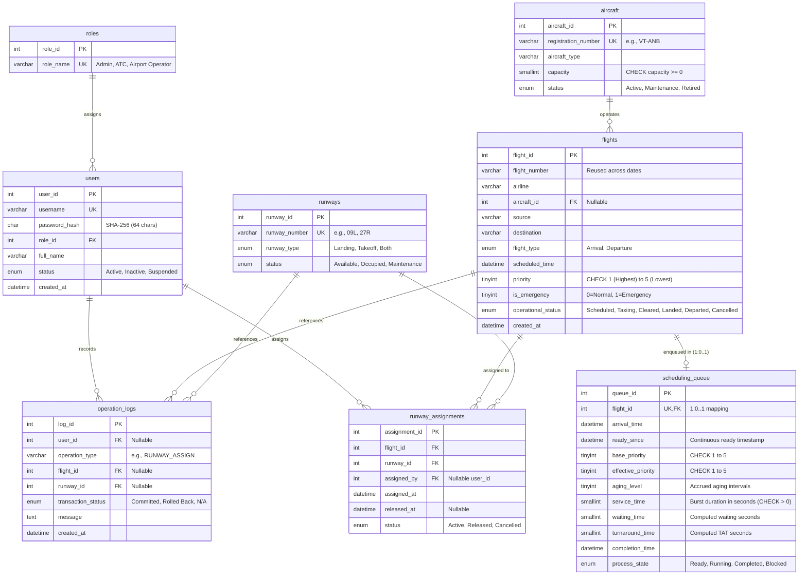

# Database Schema Specification — SmartATC

## 1. Overview of the 8-Table Relational Schema

The Smart Air Traffic Control Management System (`SmartATC`) database (`smartatc`) consists of **eight normalized relational tables** managed by the **MySQL InnoDB** storage engine using `utf8mb4` encoding and `utf8mb4_unicode_ci` collation.

The schema is defined in `sql/schema.sql` and maintains strict referential integrity across application roles, users, aircraft fleet records, flight schedules, runway resources, process queues, assignments, and audit logs.

---

## 2. Table Specifications

### 2.1 Table: `roles`
Stores application authorization roles.

| Column | Data Type | Null | Key | Default | Description |
|:---|:---|:---:|:---:|:---:|:---|
| `role_id` | `INT` | NO | **PK** | *Auto-increment* | Primary role identifier. |
| `role_name` | `VARCHAR(50)` | NO | **UK** | *None* | Role name (`Admin`, `ATC`, `Airport Operator`). |

---

### 2.2 Table: `users`
Stores user accounts. Passwords are saved strictly as SHA-256 hexadecimal digests.

| Column | Data Type | Null | Key | Default | Description |
|:---|:---|:---:|:---:|:---:|:---|
| `user_id` | `INT` | NO | **PK** | *Auto-increment* | Unique user account ID. |
| `username` | `VARCHAR(50)` | NO | **UK** | *None* | Unique alphanumeric login username. |
| `password_hash` | `CHAR(64)` | NO | | *None* | SHA-256 hex string digest (64 chars). |
| `role_id` | `INT` | NO | **FK** | *None* | References `roles(role_id)`. |
| `full_name` | `VARCHAR(100)` | NO | | `''` | Full legal name of user. |
| `status` | `ENUM('Active','Inactive','Suspended')` | NO | | `'Active'` | Account lifecycle state. |
| `created_at` | `DATETIME` | NO | | `CURRENT_TIMESTAMP` | Account creation timestamp. |

**Foreign Keys & Constraints:**
- `fk_users_role_id`: `FOREIGN KEY (role_id) REFERENCES roles (role_id) ON DELETE RESTRICT ON UPDATE CASCADE`

---

### 2.3 Table: `aircraft`
Maintains registered physical aircraft in the airport fleet.

| Column | Data Type | Null | Key | Default | Description |
|:---|:---|:---:|:---:|:---:|:---|
| `aircraft_id` | `INT` | NO | **PK** | *Auto-increment* | Unique aircraft record identifier. |
| `registration_number` | `VARCHAR(20)` | NO | **UK** | *None* | Tail registration code (e.g., `VT-ANB`). |
| `aircraft_type` | `VARCHAR(50)` | NO | | `''` | Airframe type model (e.g., `Boeing 777-300ER`). |
| `capacity` | `SMALLINT UNSIGNED` | NO | | `0` | Passenger capacity. |
| `status` | `ENUM('Active','Maintenance','Retired')` | NO | | `'Active'` | Operational airworthiness status. |

**Check Constraints:**
- `chk_aircraft_capacity`: `CHECK (capacity >= 0)`

---

### 2.4 Table: `flights`
Stores commercial flight schedules and operational states.

| Column | Data Type | Null | Key | Default | Description |
|:---|:---|:---:|:---:|:---:|:---|
| `flight_id` | `INT` | NO | **PK** | *Auto-increment* | Unique flight identifier. |
| `flight_number` | `VARCHAR(10)` | NO | **IDX** | *None* | Flight number (e.g., `AI-101`), reused across dates. |
| `airline` | `VARCHAR(100)` | NO | | `''` | Operating airline carrier. |
| `aircraft_id` | `INT` | YES | **FK** | `NULL` | References assigned `aircraft(aircraft_id)`. |
| `source` | `VARCHAR(100)` | NO | | `''` | Origin airport ICAO/IATA code. |
| `destination` | `VARCHAR(100)` | NO | | `''` | Destination airport ICAO/IATA code. |
| `flight_type` | `ENUM('Arrival','Departure')` | NO | | `'Arrival'` | Operational movement classification. |
| `scheduled_time` | `DATETIME` | NO | **IDX** | *None* | Scheduled movement timestamp. |
| `priority` | `TINYINT UNSIGNED` | NO | | `3` | Base priority: **1 (Highest) to 5 (Lowest)**. |
| `is_emergency` | `TINYINT(1)` | NO | | `0` | Emergency flag (0 = Normal, 1 = Emergency distress). |
| `operational_status` | `ENUM('Scheduled','Taxiing','Cleared','Landed','Departed','Cancelled')` | NO | **IDX** | `'Scheduled'` | Current operational lifecycle status. |
| `created_at` | `DATETIME` | NO | | `CURRENT_TIMESTAMP` | Record creation timestamp. |

**Foreign Keys & Constraints:**
- `fk_flights_aircraft_id`: `FOREIGN KEY (aircraft_id) REFERENCES aircraft (aircraft_id) ON DELETE SET NULL ON UPDATE CASCADE`
- `chk_flights_priority`: `CHECK (priority BETWEEN 1 AND 5)`
- `idx_flights_number_time`: Composite index on `(flight_number, scheduled_time)`
- `idx_flights_operational_status`: Index on `(operational_status)`

---

### 2.5 Table: `runways`
Represents physical airport runway infrastructure (shared exclusive resources).

| Column | Data Type | Null | Key | Default | Description |
|:---|:---|:---:|:---:|:---:|:---|
| `runway_id` | `INT` | NO | **PK** | *Auto-increment* | Primary runway identifier. |
| `runway_number` | `VARCHAR(10)` | NO | **UK** | *None* | Runway designation code (e.g., `09L`, `27R`). |
| `runway_type` | `ENUM('Landing','Takeoff','Both')` | NO | | `'Both'` | Operational designation. |
| `status` | `ENUM('Available','Occupied','Maintenance')` | NO | | `'Available'` | Real-time resource state. |

---

### 2.6 Table: `scheduling_queue`
Stores Process Control Block (PCB) simulation attributes for flights in the OS scheduler.

| Column | Data Type | Null | Key | Default | Description |
|:---|:---|:---:|:---:|:---:|:---|
| `queue_id` | `INT` | NO | **PK** | *Auto-increment* | Queue entry identifier. |
| `flight_id` | `INT` | NO | **UK, FK**| *None* | References `flights(flight_id)` (1:0..1 relation). |
| `arrival_time` | `DATETIME` | NO | **IDX** | `CURRENT_TIMESTAMP` | Queue arrival timestamp. |
| `ready_since` | `DATETIME` | YES | | `NULL` | Start of continuous `Ready` state waiting. |
| `base_priority` | `TINYINT UNSIGNED` | NO | | `3` | Base priority copied from flight (1=Highest...5=Lowest). |
| `effective_priority` | `TINYINT UNSIGNED` | NO | **IDX** | `3` | Dynamic priority adjusted by aging or emergency (1..5). |
| `aging_level` | `TINYINT UNSIGNED` | NO | | `0` | Number of completed aging intervals accrued. |
| `service_time` | `SMALLINT UNSIGNED` | NO | | `60` | Simulated service duration / burst in seconds. |
| `waiting_time` | `SMALLINT UNSIGNED` | YES | | `NULL` | Computed seconds spent in ready queue ($TAT - BT$). |
| `turnaround_time`| `SMALLINT UNSIGNED` | YES | | `NULL` | Computed turnaround seconds ($CT - AT$). |
| `completion_time`| `DATETIME` | YES | | `NULL` | Timestamp when process reached `Completed` state. |
| `process_state` | `ENUM('Ready','Running','Completed','Blocked')` | NO | | `'Ready'` | Lifecycle process state. |

**Foreign Keys & Constraints:**
- `fk_sq_flight_id`: `FOREIGN KEY (flight_id) REFERENCES flights (flight_id) ON DELETE CASCADE ON UPDATE CASCADE`
- `uq_sq_flight_id`: Unique key on `flight_id` enforcing at most one queue record per flight.
- `chk_sq_base_priority`: `CHECK (base_priority BETWEEN 1 AND 5)`
- `chk_sq_effective_priority`: `CHECK (effective_priority BETWEEN 1 AND 5)`
- `chk_sq_service_time`: `CHECK (service_time > 0)`
- `idx_sq_effective_priority`: Composite index on `(effective_priority, arrival_time)` for scheduler candidate sorting.

---

### 2.7 Table: `runway_assignments`
Maintains historical and active records of runway allocations.

| Column | Data Type | Null | Key | Default | Description |
|:---|:---|:---:|:---:|:---:|:---|
| `assignment_id` | `INT` | NO | **PK** | *Auto-increment* | Unique assignment log ID. |
| `flight_id` | `INT` | NO | **FK, IDX** | *None* | Assigned flight. |
| `runway_id` | `INT` | NO | **FK, IDX** | *None* | Assigned runway. |
| `assigned_by` | `INT` | YES | **FK** | `NULL` | User who authorized allocation (references `users.user_id`). |
| `assigned_at` | `DATETIME` | NO | | `CURRENT_TIMESTAMP` | Timestamp allocation began. |
| `released_at` | `DATETIME` | YES | | `NULL` | Timestamp runway was released (`NULL` while Active). |
| `status` | `ENUM('Active','Released','Cancelled')` | NO | **IDX** | `'Active'` | Assignment status. |

**Foreign Keys & Indexes:**
- `fk_ra_flight_id`: `FOREIGN KEY (flight_id) REFERENCES flights (flight_id) ON DELETE RESTRICT ON UPDATE CASCADE`
- `fk_ra_runway_id`: `FOREIGN KEY (runway_id) REFERENCES runways (runway_id) ON DELETE RESTRICT ON UPDATE CASCADE`
- `fk_ra_assigned_by`: `FOREIGN KEY (assigned_by) REFERENCES users (user_id) ON DELETE SET NULL ON UPDATE CASCADE`
- `idx_ra_runway_status`: Composite index on `(runway_id, status)` for fast active-occupancy lookup.
- `idx_ra_flight_id`: Index on `(flight_id)`.

---

### 2.8 Table: `operation_logs`
Immutable audit trail capturing all system transactions and administrative actions.

| Column | Data Type | Null | Key | Default | Description |
|:---|:---|:---:|:---:|:---:|:---|
| `log_id` | `INT` | NO | **PK** | *Auto-increment* | Unique log entry identifier. |
| `user_id` | `INT` | YES | **FK, IDX** | `NULL` | User performing operation (references `users.user_id`). |
| `operation_type` | `VARCHAR(50)` | NO | **IDX** | *None* | Classification (e.g., `RUNWAY_ASSIGN`, `RUNWAY_RELEASE`). |
| `flight_id` | `INT` | YES | **FK, IDX** | `NULL` | Associated flight ID (if applicable). |
| `runway_id` | `INT` | YES | **FK** | `NULL` | Associated runway ID (if applicable). |
| `transaction_status` | `ENUM('Committed','Rolled Back','N/A')` | NO | | `'N/A'` | Transaction outcome. |
| `message` | `TEXT` | YES | | `NULL` | Human-readable event description. |
| `created_at` | `DATETIME` | NO | **IDX** | `CURRENT_TIMESTAMP` | Event timestamp. |

**Foreign Keys & Indexes:**
- `fk_ol_user_id`: `FOREIGN KEY (user_id) REFERENCES users (user_id) ON DELETE SET NULL ON UPDATE CASCADE`
- `fk_ol_flight_id`: `FOREIGN KEY (flight_id) REFERENCES flights (flight_id) ON DELETE SET NULL ON UPDATE CASCADE`
- `fk_ol_runway_id`: `FOREIGN KEY (runway_id) REFERENCES runways (runway_id) ON DELETE SET NULL ON UPDATE CASCADE`
- `idx_ol_operation_type`: Index on `(operation_type)`
- `idx_ol_created_at`: Index on `(created_at)`
- `idx_ol_user_id`: Index on `(user_id)`
- `idx_ol_flight_id`: Index on `(flight_id)`

---

## 3. Relational Normalization Proofs (1NF, 2NF, 3NF)

The schema satisfies the requirements of **Third Normal Form (3NF)**:

### 3.1 First Normal Form (1NF)
1. **Atomic Values:** Every column contains indivisible, scalar values. No composite or multi-valued attributes (such as comma-separated lists of flights or roles) exist.
2. **Explicit Primary Keys:** Every table defines an explicit integer primary key (`role_id`, `user_id`, `aircraft_id`, `flight_id`, `runway_id`, `queue_id`, `assignment_id`, `log_id`).

### 3.2 Second Normal Form (2NF)
1. The schema is in 1NF.
2. **No Partial Functional Dependencies:** In all tables with simple single-column primary keys, every non-key attribute depends entirely on the entire primary key. In `flights`, attributes like `airline` and `scheduled_time` depend fully on `flight_id`. Separating aircraft into `aircraft` prevents repeating airframe attributes across multiple flights.

### 3.3 Third Normal Form (3NF)
1. The schema is in 2NF.
2. **No Transitive Dependencies:** No non-key attribute is transitively dependent on another non-key attribute:
   - In `users`: `role_name` is not stored in `users`; only `role_id` is maintained, referencing `roles(role_id)`.
   - In `flights`: `aircraft_type` and `capacity` are not stored in `flights`; only `aircraft_id` is stored, referencing `aircraft(aircraft_id)`.
   - In `runways`: assignment history is decoupled into `runway_assignments`, avoiding transitive relationships between runway attributes and flight operations.
