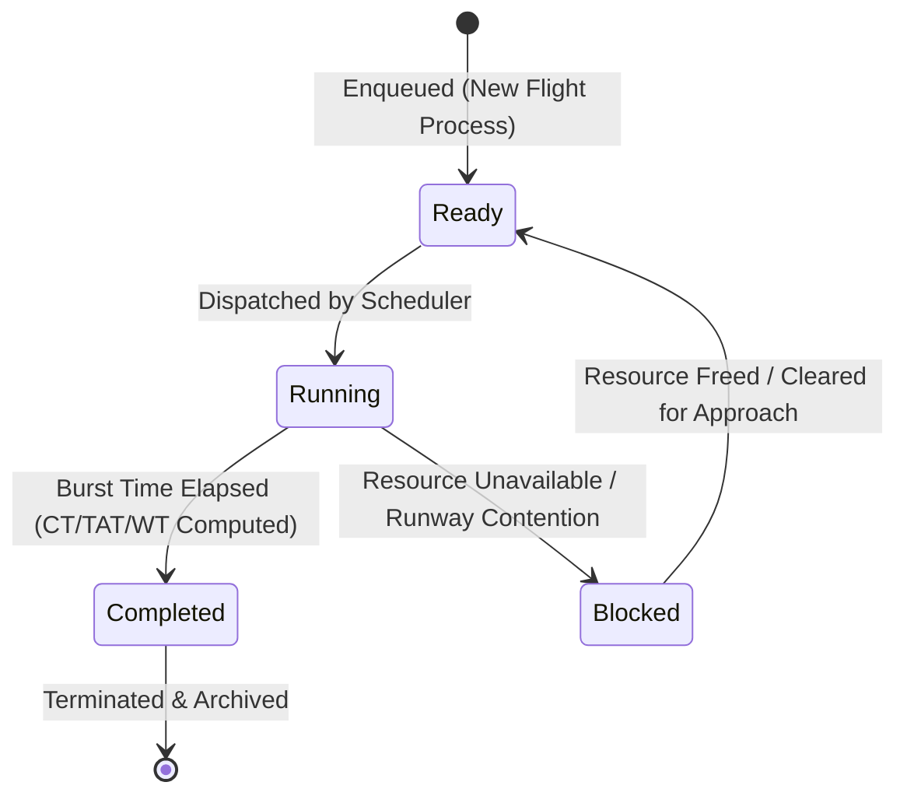
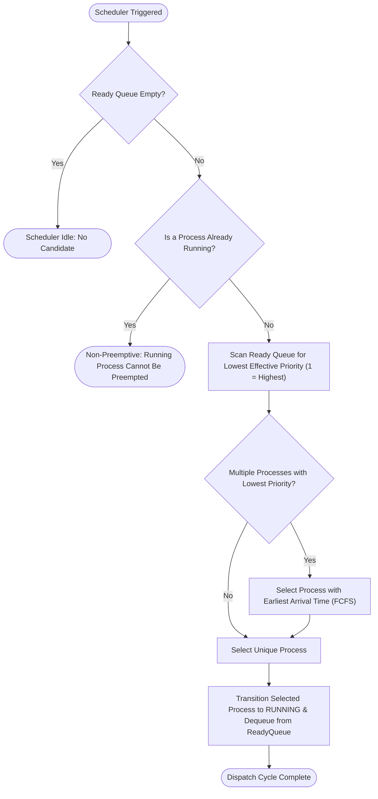
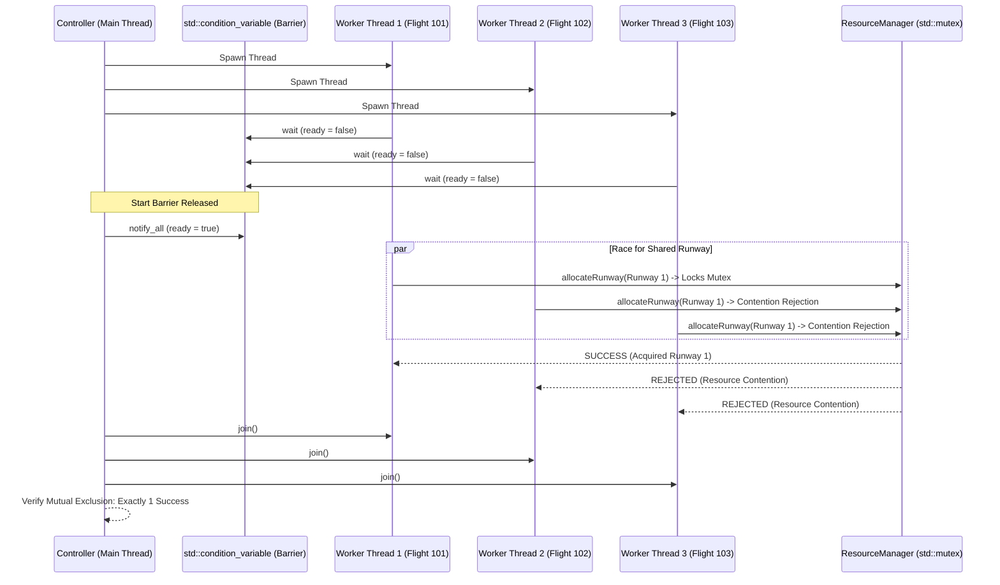

# Operating System Concepts — Implementation in SmartATC

## 1. Overview & Simulation Scope

SmartATC models core computer Operating System concepts within an air traffic control domain. 

> [!NOTE]
> **Application-Level Simulation vs. Kernel-Level Scheduler:**
> In SmartATC, the scheduler and synchronization primitives operate at the **application level** within user space. The "processes" are C++ objects representing flight operations, and "CPU dispatching" simulates assigning an aircraft to an exclusive runway resource. The host operating system (Windows) runs SmartATC itself as a standard process; SmartATC does not alter the host kernel's task dispatcher.

---

## 2. Process Management & The Process Control Block (PCB)

### 2.1 Flight-to-Process Mapping
In an operating system, a program in execution is a process. In SmartATC, an active flight operation is modeled as a simulated process:
- **Flight ID (`flightId`):** Serves as the simulated Process Identifier (PID).
- **Service Duration (`serviceTime`):** Represents the CPU Burst Time (the number of seconds the aircraft requires exclusive use of the runway).
- **Arrival Time (`arrivalTime`):** The timestamp when the process entered the runnable pool.
- **Queue ID (`queueId`):** The unique primary key linking the PCB to the persistent database scheduling queue.

### 2.2 PCB Structure (`Models::Process`)
The Process Control Block is implemented in C++ as `Models::Process` in `src/models/Process.h`:

```cpp
struct Process {
    int         id                 = 0;   // queue_id
    int         flightId           = 0;   // simulated PID
    QDateTime   arrivalTime;              // timestamp entered ready queue
    int         basePriority       = 3;   // static priority (1=highest ... 5=lowest)
    int         effectivePriority  = 3;   // dynamic priority (aging/emergency adjusted)
    QDateTime   readySince;               // continuous READY duration start
    int         agingLevel         = 0;   // number of accrued aging intervals
    bool        isEmergency        = false;// emergency priority override flag
    int         serviceTime        = 60;  // CPU burst time in seconds
    ProcessState state             = ProcessState::Ready;
    
    // Computed Performance Metrics
    int         waitingTime        = -1;  // WT in seconds (-1 = uncomputed)
    int         turnaroundTime     = -1;  // TAT in seconds
    QDateTime   completionTime;           // CT timestamp
};
```

### 2.3 Process Lifecycle & State Machine
The process lifecycle transitions strictly through four discrete states:



| State | OS Concept Equivalent | SmartATC Implementation Meaning |
|---|---|---|
| **`Ready`** | Runnable process in ready queue | Flight enqueued, awaiting runway dispatch. Eligible for aging. |
| **`Running`** | Process actively executing on CPU | Flight dispatched; actively landing or taking off on assigned runway. |
| **`Blocked`** | Waiting on I/O or external event | Flight held in holding pattern due to weather or runway maintenance. |
| **`Completed`**| Process terminated; resources released | Runway vacated; turnaround and waiting time metrics recorded. |

---

## 3. CPU Scheduling Simulation

### 3.1 Non-Preemptive Priority Scheduling
SmartATC implements **Non-Preemptive Priority Scheduling**. 

Key scheduling rules:
1. **Priority Scale:** Priorities range from **1 to 5**, where:
   - **`1` = Highest Priority** (Emergency, VIP, critical flights)
   - **`3` = Normal Priority** (Standard scheduled commercial flights)
   - **`5` = Lowest Priority** (Cargo, non-urgent general aviation)
2. **Deterministic Selection:** The scheduler selects the process with the **lowest numerical effective priority**.
3. **Tie-Breaking:**
   - *Primary Tie-Breaker:* Earlier **Arrival Time** (First-Come, First-Served among equal priorities).
   - *Secondary Tie-Breaker:* Smaller **Flight ID** (guarantees mathematical determinism).
4. **Non-Preemptive Dispatch:** Once a process transitions to `Running`, it retains control of the simulated CPU (runway) until its burst time expires. Newly arriving higher-priority processes must wait in the `ReadyQueue`.



---

## 4. Scheduling Metrics & Formulas

Upon process completion, the scheduler records three fundamental scheduling metrics:

### 4.1 Formulas
1. **Completion Time ($CT$):** The exact timestamp at which process execution terminates.
   $$CT = \text{Start Time} + \text{Burst Time} \quad (\text{or } t_{\text{completed}})$$
2. **Turnaround Time ($TAT$):** The total elapsed time from arrival in the ready queue to final completion.
   $$TAT = CT - \text{Arrival Time} \quad (\text{measured in seconds})$$
3. **Waiting Time ($WT$):** The total duration spent waiting in the ready queue before receiving execution.
   $$WT = TAT - \text{Burst Time} \quad (\text{or Start Time} - \text{Arrival Time})$$
4. **Aggregate Averages:**
   $$\overline{WT} = \frac{1}{N} \sum_{i=1}^N WT_i, \quad \overline{TAT} = \frac{1}{N} \sum_{i=1}^N TAT_i$$

### 4.2 Concrete Example Calculation

Consider three arriving processes scheduled sequentially on a single runway starting at time $t = 0$:

| Process | Arrival Time ($AT$) | Burst Time ($BT$) | Priority | Start Time | Completion Time ($CT$) | Turnaround Time ($TAT = CT - AT$) | Waiting Time ($WT = TAT - BT$) |
|:---:|:---:|:---:|:---:|:---:|:---:|:---:|:---:|
| **P1** | 0s | 40s | 2 | 0s | 40s | $40 - 0 = \mathbf{40s}$ | $40 - 40 = \mathbf{0s}$ |
| **P2** | 5s | 30s | 1 | 40s | 70s | $70 - 5 = \mathbf{65s}$ | $65 - 30 = \mathbf{35s}$ |
| **P3** | 10s | 20s | 3 | 70s | 90s | $90 - 10 = \mathbf{80s}$ | $80 - 20 = \mathbf{60s}$ |

- **Average Turnaround Time:** $\overline{TAT} = \frac{40 + 65 + 80}{3} = \frac{185}{3} \approx \mathbf{61.67\text{ seconds}}$
- **Average Waiting Time:** $\overline{WT} = \frac{0 + 35 + 60}{3} = \frac{95}{3} \approx \mathbf{31.67\text{ seconds}}$

---

## 5. Dynamic Emergency Priority Overrides

In aviation, low fuel, cabin depressurization, or engine failure requires immediate emergency landing priority. In operating systems, this corresponds to a **High-Priority Interrupt (NMI)**.

### Implementation:
1. **Dynamic Priority Separation:** SmartATC maintains two priority values on every PCB:
   - `basePriority`: The intrinsic priority of the flight (1 to 5). **Never modified by emergencies or aging.**
   - `effectivePriority`: The dynamic scheduling value used by `Scheduler::selectNextProcess()`.
2. **Emergency Declaration:** When an ATC controller flags a flight as emergency (`is_emergency = true`):
   $$\text{effectivePriority} = 1 \quad (\text{Highest Priority})$$
3. **Emergency Resolution:** When the emergency is resolved:
   $$\text{effectivePriority} = \max(1, \text{basePriority} - \text{agingLevel})$$
   The process seamlessly drops back to its appropriate aging-accrued priority without losing any accrued waiting benefits.

---

## 6. Priority Aging and Starvation Prevention

### 6.1 The Starvation Problem (Indefinite Blocking)
In strict priority scheduling, a major vulnerability is **starvation**: a low-priority process (Priority 4 or 5) may wait indefinitely in the ready queue if a steady stream of higher-priority processes (Priority 1 or 2) continues to arrive.

### 6.2 The Priority Aging Algorithm
SmartATC eliminates starvation using an **Aging Engine** (`SchedulerComponents::AgingEngine`):
- **Eligibility:** Aging applies strictly to processes continuously in `ProcessState::Ready`.
- **Elapsed Duration Tracking:** Each PCB tracks `readySince` (the exact timestamp when it entered continuous waiting).
- **Aging Level Formula:** For a configured interval $T_{\text{aging}}$ (default 30 seconds):
  $$\text{agingLevel} = \min\left(255, \left\lfloor \frac{t_{\text{current}} - \text{readySince}}{T_{\text{aging}}} \right\rfloor\right)$$
- **Effective Priority Formula:**
  $$\text{effectivePriority} = \max(1, \text{basePriority} - \text{agingLevel})$$
- **Floor Bound:** Effective priority improves by 1 level per completed interval until it reaches **1** (highest priority). It is bounded to prevent values below 1.
- **Queue Reordering:** As priorities shift, `ReadyQueue::reorder()` re-sorts the queue so the aged process moves toward the head of the dispatch line.

---

## 7. Critical Sections and Mutual Exclusion

### 7.1 The Runway as a Shared Resource
A runway is a physical shared resource that cannot be shared simultaneously. If two aircraft attempt to occupy the same runway simultaneously, a catastrophic collision occurs. In operating systems, this is the classic **Critical Section Problem**.

### 7.2 Synchronization Implementation
To guarantee mutual exclusion, SmartATC implements `ResourceManager` utilizing C++ standard library synchronization primitives:
- **`std::mutex`:** Each runway critical section is guarded by an internal mutex (`std::mutex m_resourceMutex`).
- **RAII Locking (`std::unique_lock`):** All access is wrapped in scoped lock guards (`ScopedResourceLock`), ensuring that locks are unconditionally released even if an exception or early return occurs.
- **Contention Rejection:** If an allocation request arrives for a runway currently locked or allocated to another flight, `ResourceManager::allocateRunway()` immediately returns `AllocationResult::RunwayOccupied` ("Resource Contention").

---

## 8. Multi-Threading & Concurrency Simulation

SmartATC features a dedicated multithreaded stress test harness: `ConcurrentAllocationDemo`.



1. **Start Barrier (`std::condition_variable`):** Worker threads are spawned and held at a synchronization barrier. The main thread calls `cv.notify_all()`, releasing all competing threads at the exact same millisecond.
2. **Race Condition Prevention:** The threads race to execute `ResourceManager::allocateRunway()`. The internal `std::mutex` guarantees that exactly one thread succeeds; all competing threads are safely rejected.
3. **Thread Joining & Cleanup:** Every thread is explicitly joined via `thread.join()` prior to function return, preventing orphaned threads or dangling pointer dereferences.
