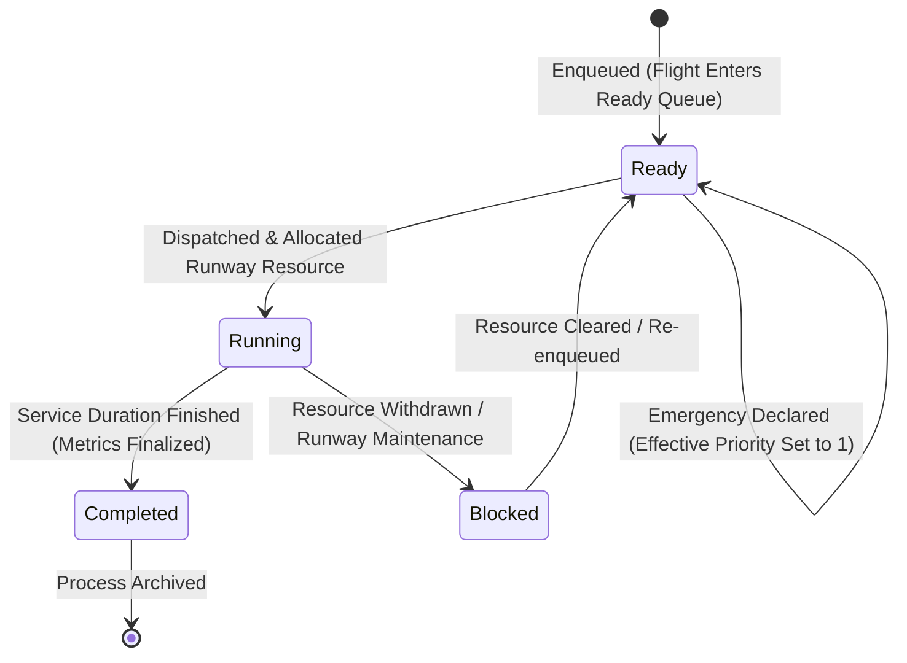

# Operating System Concepts — Implementation in SmartATC

## 1. Overview & Simulation Scope

SmartATC models core computer Operating System concepts within an air traffic control domain. 

> [!NOTE]
> **Application-Level Simulation vs. Kernel-Level Scheduler:**
> In SmartATC, the scheduler and synchronization primitives operate strictly at the **application level** in user space C++.
> - The "processes" are simulated C++ objects representing flight operations.
> - The application **does not implement a kernel-level OS scheduler** and does not alter the host operating system's task dispatcher.
> - The host operating system (Windows) runs SmartATC itself as a normal desktop process.
> - The application **does not control physical aircraft or real-world radar arrays**.

---

## 2. Core OS Conceptual Mappings

SmartATC maps aviation operations to fundamental Operating System concepts as follows:

| Operating System Concept | SmartATC Air Traffic Analogy | Implementation Mechanism |
|:---|:---|:---|
| **Simulated Process** | **Flight** | `Models::Process` representing an active flight task. |
| **Ready Queue** | **Flight Waiting Queue** | `SchedulerComponents::ReadyQueue` holding runnable tasks. |
| **Process Priority** | **Flight Priority** | Integer scale: 1 (Highest) to 5 (Lowest). |
| **High-Priority Process** | **Emergency Flight** | Dynamic escalation to effective priority 1. |
| **Shared OS Resource** | **Runway** | Critical section protected by `std::mutex` and row locks. |
| **Resource Allocation** | **Runway Assignment** | Atomic allocation of an available runway to a process. |
| **Starvation Risk** | **Long Waiting Time** | Low-priority processes delayed indefinitely by high-priority arrivals. |
| **Starvation Prevention** | **Priority Aging** | Periodic reduction of numerical priority values via `AgingEngine`. |

> [!IMPORTANT]
> **Runway as a Shared Resource (Not a CPU):**
> A runway is modeled as a **shared hardware/system resource** governed by mutual exclusion, analogous to an exclusive device. It is not an arithmetic CPU core executing instruction cycles.
> A flight process specifies a simulated service duration (`serviceTime`, default 60 seconds) representing the time required to complete takeoff or landing. During this period, the runway resource is held exclusively in `Occupied` state and cannot be allocated to any other process.

---

## 3. Process Management & The Process Control Block (PCB)

### 3.1 Flight-to-Process Representation
In an operating system, an execution entity is represented by a Process Control Block (PCB). In SmartATC, each queued flight operation has an associated PCB:
- **Flight ID (`flightId`):** Serves as the simulated Process Identifier (PID).
- **Service Duration (`serviceTime`):** Represents the duration (in seconds) the process requires exclusive allocation of a runway resource.
- **Arrival Time (`arrivalTime`):** Timestamp when the process entered the runnable pool.
- **Queue ID (`queueId`):** The primary key linking the in-memory PCB to the persistent `scheduling_queue` table.

### 3.2 PCB Structure (`Models::Process`)
Implemented in `src/models/Process.h`:

```cpp
struct Process {
    int         id                 = 0;   // queue_id
    int         flightId           = 0;   // simulated PID
    QDateTime   arrivalTime;              // timestamp entered ready queue
    int         basePriority       = 3;   // static priority (1=Highest ... 5=Lowest)
    int         effectivePriority  = 3;   // dynamic priority (aging / emergency adjusted)
    QDateTime   readySince;               // continuous READY duration start
    int         agingLevel         = 0;   // number of accrued aging intervals
    bool        isEmergency        = false;// emergency priority override flag
    int         serviceTime        = 60;  // simulated resource service duration in seconds
    ProcessState state             = ProcessState::Ready;
    
    // Computed Performance Metrics
    int         waitingTime        = -1;  // WT in seconds (-1 = uncomputed)
    int         turnaroundTime     = -1;  // TAT in seconds
    QDateTime   completionTime;           // CT timestamp
};
```

### 3.3 Process Lifecycle & State Machine
The process lifecycle transitions strictly through discrete states:



| State | OS Concept Equivalent | SmartATC Implementation Meaning |
|:---|:---|:---|
| **`Ready`** | Runnable process in ready queue | Flight enqueued, awaiting runway allocation. Eligible for priority aging. |
| **`Running`** | Process actively executing with resource | Flight dispatched; actively utilizing allocated runway resource. |
| **`Blocked`** | Waiting on resource availability | Flight held due to runway maintenance or operational suspension. |
| **`Completed`**| Process terminated; resources released | Runway vacated; turnaround and waiting time metrics recorded. |

---

## 4. Priority Scheduling Simulation

### 4.1 Non-Preemptive Priority Scheduling
SmartATC implements **Non-Preemptive Priority Scheduling**.

Key scheduling rules:
1. **Priority Scale:** Priorities range from **1 to 5**:
   - **`1` = Highest Priority** (Emergency, distress calls)
   - **`2` = High Priority** (Long-haul, international arrivals)
   - **`3` = Normal Priority** (Standard scheduled passenger flights; default)
   - **`4` = Low Priority** (Regional commuter flights)
   - **`5` = Lowest Priority** (Cargo, repositioning, non-urgent general aviation)
2. **Precedence Rule:** Lower numerical value denotes higher priority:
   $$\text{Precedence: } 1 > 2 > 3 > 4 > 5$$
3. **Deterministic Candidate Selection:** `Scheduler::selectNextProcess()` scans the `ReadyQueue` for the process with the **lowest numerical effective priority** (effectivePriority ASC).
4. **Tie-Breaking Hierarchy:**
   - *Primary Tie-Breaker:* Earlier **Arrival Time** (First-Come, First-Served / FCFS among equal priorities).
   - *Secondary Tie-Breaker:* Smaller **Flight ID** (guarantees mathematical determinism).
5. **Non-Preemptive Execution:** Once a process transitions to `Running` and acquires a runway, it holds that resource non-preemptively until release. A newly arriving Emergency flight (Priority 1) does not evict the running process; instead, it is placed at the head of the `ReadyQueue` and dispatched at the very next resource availability.

---

## 5. Scheduling Metrics & Mathematical Formulas

The scheduling engine computes standard performance metrics:

### 5.1 Completion Time ($CT$)
The wall-clock timestamp when the process finishes its service duration and releases the runway resource.

### 5.2 Turnaround Time ($TAT$)
Total elapsed time from process arrival in the ready queue to final completion:
$$TAT = CT - AT$$

### 5.3 Waiting Time ($WT$)
Total duration spent by the process waiting in the ready queue prior to execution:
$$WT = TAT - BT$$
*(where $BT$ is the service duration / burst time).*

### 5.4 Response Time ($RT$)
Elapsed time from arrival until first dispatch to the `Running` state. In non-preemptive scheduling without interruption:
$$RT = WT$$

---

## 6. Priority Aging & Starvation Prevention

### 6.1 Starvation Problem
In pure priority scheduling, a continuous influx of high-priority processes (Priority 1, 2, or 3) can cause low-priority processes (Priority 4 or 5) to wait indefinitely. This condition is known as **starvation** (indefinite postponement).

### 6.2 Priority Aging Algorithm
The `AgingEngine` eliminates starvation by periodically adjusting the dynamic priority of processes waiting in the `ReadyQueue`:
1. **Condition:** Applies exclusively to processes with `state == ProcessState::Ready`.
2. **Elapsed Time:** Tracks `readySince` (timestamp of entry into continuous `Ready` state).
3. **Aging Interval ($T_{\text{aging}}$):** Configurable duration (default: 30 seconds).
4. **Aging Level:**
   $$\text{agingLevel} = \min\left(255, \left\lfloor \frac{t_{\text{now}} - \text{readySince}}{T_{\text{aging}}} \right\rfloor\right)$$
5. **Effective Priority Formulation:**
   $$\text{effectivePriority} = \max(1, \text{basePriority} - \text{agingLevel})$$
6. **Boundary Protection:** Effective priority improves by decrementing its numerical value. It is bounded at **1** (cannot become 0 or negative).
7. **Base Priority Preservation:** `basePriority` is never modified by aging, ensuring that if the process is requeued, its original baseline priority remains known.

---

## 7. Critical Sections & Mutual Exclusion

### 7.1 Shared Resource Contention
A runway is a shared physical resource. If two flight worker threads attempt to allocate the same runway simultaneously, a **race condition** occurs, potentially producing conflicting assignments.

### 7.2 Mutual Exclusion via `std::mutex` and RAII
To prevent race conditions, `ResourceManager` protects runway state transitions using `std::mutex`:
- Critical sections encompass checking runway availability, validating compatibility, and transitioning status to `Occupied`.
- The RAII helper `ResourceManager::ScopedResourceLock` guarantees automatic unlocking when execution leaves scope, eliminating deadlocks from unhandled exceptions.

```cpp
// RAII Scoped Lock Pattern in ResourceManager
{
    std::unique_lock<std::mutex> lock(m_resourceMutex);
    // CRITICAL SECTION START
    if (runway.status == RunwayStatus::Available) {
        runway.status = RunwayStatus::Occupied;
        runway.currentFlightId = flightId;
    }
    // CRITICAL SECTION END (lock released automatically on destruction)
}
```

### 7.3 Concurrency Demonstration (`ConcurrentAllocationDemo`)
`ConcurrentAllocationDemo` demonstrates thread safety by launching multiple concurrent C++ worker threads (`std::thread`) that compete simultaneously for the same runway:
- The mutex serializes access to the critical section.
- Exactly one thread succeeds in acquiring the runway; subsequent threads are safely rejected or queued.
- Proves race-condition prevention and shared-resource mutual exclusion in C++.
