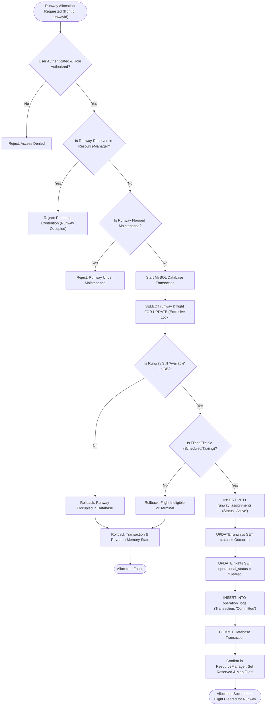

# Runway Resource Allocation Specification — SmartATC

## 1. The Runway as a Shared Resource

In an operating system, hardware resources like a dedicated processor core, GPU pipeline, or storage write-head can only execute one task at a time. In SmartATC, the **Airport Runway** represents this shared resource.

### Operational Constraints:
1. **Physical Exclusivity:** A runway can physically accommodate only one aircraft movement at a time.
2. **Safety Buffer:** Allocation must be atomic; any ambiguity in assignment status could allow two flights to enter the active runway simultaneously.
3. **Operational Specialization:** Runways possess physical properties (length, approach systems) optimized for specific flight operations (`Landing`, `Takeoff`, or `Both`).

---

## 2. Runway States & Compatibility Matrix

### 2.1 Runway Operational Statuses
Every runway in SmartATC exists in one of three states:
- **`Available`:** The runway is operational, clear of traffic, and ready for immediate allocation.
- **`Occupied`:** An aircraft is actively landing, rolling out, or executing a takeoff run. The runway is an active critical section.
- **`Maintenance`:** The surface is closed for inspection, snow clearance, or repairs. All flight requests are rejected.

### 2.2 Compatibility Matrix
`ApplicationService::findCompatibleAvailableRunway()` matches flight operation requirements against runway capabilities:

| Flight Operation | Runway Type: `Landing` | Runway Type: `Takeoff` | Runway Type: `Both` |
|---|:---:|:---:|:---:|
| **`Arrival`** | **Compatible** | Incompatible | **Compatible** |
| **`Departure`** | Incompatible | **Compatible** | **Compatible** |

---

## 3. Allocation Eligibility & Dual-Layer State Management

To prevent stale allocations, SmartATC enforces state synchronization across two layers:
1. **In-Memory Layer (`ResourceManager`):** Uses C++ `std::mutex` and map lookups for instant microsecond-level conflict rejection and multi-threaded synchronization.
2. **Database Layer (`MySQL InnoDB`):** Uses relational tables (`runways`, `runway_assignments`, `flights`) with row-level locks for persistent ACID reliability.

### 3.1 Eligibility Criteria:
A flight is eligible for runway allocation if and only if:
1. It is not in a terminal state (`Landed`, `Departed`, `Cancelled`).
2. It does not already possess an active runway assignment.
3. A compatible runway exists that is currently `Available` in MySQL and not reserved in `ResourceManager`.

---

## 4. Runway Allocation Flowchart

---

## 5. Unavailability Handling Policy

When `scheduleAndAllocateNext()` executes, it may encounter a scenario where the highest-priority flight in the `ReadyQueue` has **no compatible available runway**:

1. **State Preservation:** The process **remains in the `ReadyQueue`** in `ProcessState::Ready`. It is not dropped, canceled, or marked failed.
2. **Burst Protection:** The process is not dispatched to `Running`.
3. **Continuous Aging:** The flight continues accumulating elapsed waiting time in `Ready` state, ensuring its priority continues to age.
4. **Non-Blocking Operation:** The system reports `"Resource Unavailable: No compatible available runway found"`, allowing the controller to resolve runway congestion or wait for a runway to be released.

---

## 6. Runway Release Lifecycle

When an aircraft completes its landing rollout or departure climb:
1. **Trigger:** The ATC controller triggers `ApplicationService::releaseRunway(runwayId)`.
2. **Transaction Sequence:**
   - Active assignment record in `runway_assignments` is updated to `status = 'Completed'`, and `released_at` is stamped.
   - `runways.status` is reset to `'Available'`.
   - Flight operational status transitions to `'Landed'` (Arrival) or `'Departed'` (Departure).
   - An audit log is inserted into `operation_logs`.
   - `COMMIT` executes.
3. **In-Memory Clearance:** `ResourceManager::releaseRunway()` unlocks the runway mutex, clears internal ownership maps, and emits `runwaysChanged()`.
4. **Immediate Reusability:** The runway is immediately eligible for the next candidate process in the ready queue.
