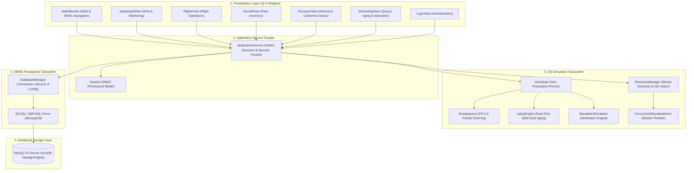
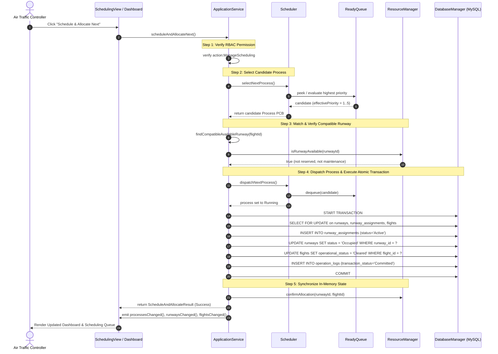

# System Architecture — Smart Air Traffic Control Management System (SmartATC)

## 1. Architectural Philosophy & Layered Model

SmartATC is designed around a clean, decoupled **Layered Facade Architecture**. This ensures a strict separation of concerns between:
1. Presentation & user interaction (Qt GUI).
2. Centralized business logic & security enforcement (Application Service Facade).
3. Operating System simulation (Scheduler, Ready Queue, Aging Engine, Resource Manager).
4. Relational database connectivity, transactions, and persistence (Database Manager & Qt SQL).

---

## 2. Layer Responsibilities & Component Details

### 2.1 Layer 1: Presentation Layer (Qt 6 Widgets)
The presentation layer provides an event-driven desktop interface that interacts with the underlying services strictly through signals, slots, and method calls on `ApplicationService`:
- **`MainWindow`:** Serves as the central navigation shell. Holds a `QStackedWidget` for page swapping and dynamically enables or hides sidebar items based on the active user's permissions (`session.hasPermission(...)`).
- **`DashboardView`:** Real-time data-driven operational monitoring center displaying KPI cards, emergency alerts, utilization bars, and operation audit logs.
- **`FlightsView`:** Tabular view of flight schedules with filtering by flight type and status, flight creation dialogs, and emergency toggles.
- **`AircraftView`:** Fleet inventory interface tracking airframe registrations, passenger capacity, and maintenance status.
- **`RunwaysView`:** Runway asset management view featuring the multi-threaded `ConcurrentAllocationDemo` control panel.
- **`SchedulingView`:** Interactive scheduling interface displaying the live ready queue, priority aging configuration, manual dispatch controls, and the starvation demonstration replay module.
- **`LoginView`:** Secure credential entry form with password masking and error feedback.

### 2.2 Layer 2: Application Service Layer (`ApplicationService`)
Acts as a unified **Facade** over the entire system. UI views never directly access database queries, mutex locks, or scheduler queues; all operations route through `ApplicationService`:
1. **Centralized RBAC Enforcement:** Every method validates `isAuthenticated()` and checks permission keys (`action:ManageScheduling`, `action:RunwayAllocation`, etc.) before proceeding.
2. **End-to-End Workflow Orchestration:** Coordinates multi-system operations like `scheduleAndAllocateNext()`, which involves candidate selection from the `Scheduler`, availability verification in `ResourceManager`, and transaction execution in `DatabaseManager`.
3. **Event Notification (Observer Pattern):** Emits Qt signals (`flightsChanged()`, `runwaysChanged()`, `processesChanged()`, `agingEvaluated()`) to keep all open GUI views in sync without tight coupling.

### 2.3 Layer 3: Operating System Simulation Subsystem
Implements the core OS principles in modern C++17:
- **`Models::Process` (Process Control Block):** C++ PCB holding process ID (`flightId`), queue ID, base priority, dynamic priority (`effectivePriority`), service duration, arrival timestamp, and state enum (`Ready`, `Running`, `Blocked`, `Completed`).
- **`ReadyQueue`:** In-memory queue storing runnable simulated processes. Enforces FIFO insertion, uniqueness checks, and priority/aging-driven reordering.
- **`Scheduler`:** Executes Non-Preemptive Priority Scheduling. Determines the highest priority candidate (lowest numerical priority value, broken by arrival time). Dispatches processes to `Running` and records completion metrics (CT, TAT, WT).
- **`AgingEngine`:** Background `QTimer`-driven engine that computes elapsed wall-clock waiting time in `Ready` state and decrements numerical priority value per interval.
- **`StarvationSimulation`:** Dedicated simulation harness that runs dual-track scenarios comparing scheduling outcomes with and without priority aging.
- **`ResourceManager`:** Thread-safe resource controller protecting physical runways. Manages in-memory allocations and critical sections using `std::mutex` and `ScopedResourceLock`.
- **`ConcurrentAllocationDemo`:** Multithreaded testbed using `std::thread` and `std::condition_variable` start-barriers to simulate race conditions on shared runways.

### 2.4 Layer 4: DBMS Persistence Subsystem
- **`DatabaseManager`:** Thread-safe singleton managing the MySQL connection pool (`SmartATCConnection`). Reads connection parameters from `db.conf`, manages connection lifecycle (`connect()`, `disconnect()`, `checkConnection()`), and sanitizes error messages.
- **Qt SQL Layer:** Employs `QSqlDatabase` and `QSqlQuery` utilizing the native `QMYSQL` plugin linked against MySQL's 64-bit client C library (`libmysql.dll`).
- **Transaction Manager:** Groups multi-statement operations into atomic blocks using `db.transaction()`, `db.commit()`, and `db.rollback()`. Employs pessimistic row locks (`SELECT ... FOR UPDATE`).

### 2.5 Layer 5: Relational Storage Layer (MySQL 8 InnoDB)
- **Engine:** MySQL Server 8.0.x with the default transactional `InnoDB` storage engine.
- **Schema:** 8 normalized tables: `roles`, `users`, `aircraft`, `flights`, `runways`, `scheduling_queue`, `runway_assignments`, and `operation_logs`.
- **ACID Integrity:** Foreign keys with cascading operational rules, check constraints, unique constraints, and transaction log flushing (`innodb_flush_log_at_trx_commit = 1`).

---

## 3. Component Interaction Workflow

The primary end-to-end integration path is illustrated in the sequence below:

---

## 4. Fault Tolerance & Graceful Degradation

SmartATC is built to withstand database disruptions without unhandled crashes:

| Subsystem State | Behavior & Degradation Policy |
|---|---|
| **Live MySQL Connected** | Full operational capability: persistent ACID transactions, persistent queue synchronization, audit logging, and live dashboard metrics. |
| **MySQL Disconnected (Offline)** | `DatabaseManager::checkConnection()` flags offline state. Application falls back to **in-memory simulation mode**. In-memory process scheduling, priority aging, starvation simulation, and `std::mutex` critical-section demonstrations continue running seamlessly. The GUI displays `○ DB: Disconnected` warning banners. |
| **Transaction Failure** | Any failure during multi-statement execution automatically triggers `QSqlDatabase::rollback()`. The `ResourceManager` reverts in-memory reservations via `rollbackAllocation()`, ensuring absolute parity between C++ heap state and MySQL tables. |
| **Divergent State Recovery** | The reconciliation engine (`reconcileTransactionState()`) inspects MySQL row locks, assignment records, and audit logs to resolve uncertain commit outcomes. |
