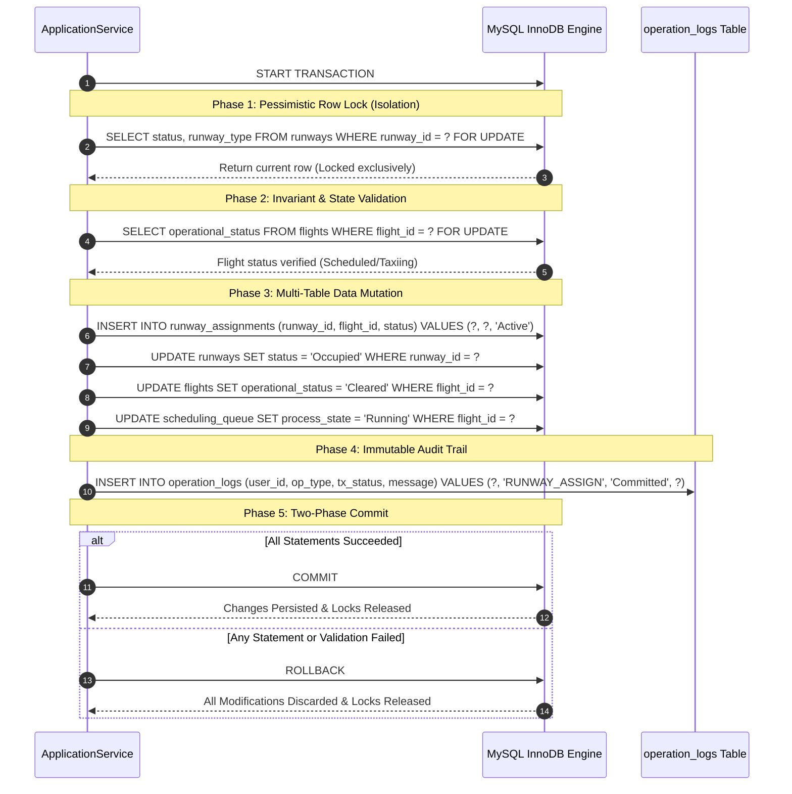

# Database Transactions and ACID Verification — SmartATC

## 1. Overview of Database Transactions

A database transaction is an indivisible unit of work comprising multiple SQL operations. In SmartATC, resource allocation and release span multiple tables: `runways`, `flights`, `runway_assignments`, `scheduling_queue`, and `operation_logs`.

If any single statement fails (e.g., duplicate assignment constraint violation, foreign key failure, or network drop), the entire operation must be rolled back to guarantee that partial, corrupt, or phantom allocations never enter the persistent database.

---

## 2. Transaction Sequence: Runway Allocation



---

## 3. The ACID Properties in SmartATC

### 3.1 Atomicity ("All or Nothing")
- **Concept:** Every statement within a transaction executes completely, or the database reverts to its exact state prior to the transaction.
- **SmartATC Implementation:** All allocation steps occur between `db.transaction()` and `db.commit()`. If an error occurs at statement 4, `db.rollback()` executes, reverting statements 1, 2, and 3.
- **Failure Injection Testing:** Tested deterministically via `setAllocationFailureStage()` in `TestACIDProperties`:
  - `DuringInsertAssignment`: Failed assignment insertion reverts runway and flight.
  - `DuringUpdateRunway`: Failed runway update reverts assignment insertion.
  - `DuringUpdateFlight`: Failed flight update discards assignment and runway occupancy.
  - `DuringInsertOperationLog`: Failed audit logging discards preceding state updates.
  - `DuringCommit`: Simulated commit failure triggers full rollback.

### 3.2 Consistency ("Valid State Transitions")
- **Concept:** Transactions transition the database from one valid state satisfying all integrity constraints to another valid state.
- **SmartATC Invariants:**
  1. *Uniqueness:* A runway cannot have more than one `Active` assignment simultaneously.
  2. *Flight Validity:* Terminal flights (`Landed`, `Departed`, `Cancelled`) cannot acquire runways.
  3. *Foreign Key Integrity:* Assignments cannot reference non-existent runways or flights.
  4. *Range Invariants:* Flight priority is strictly bounded between 1 and 5.

### 3.3 Isolation ("Concurrent Independence")
- **Concept:** Concurrent transactions execute without cross-transaction interference as if executed serially.
- **Implementation:**
  - Storage Engine: **InnoDB** default **`REPEATABLE READ`**.
  - Exclusive Locks: Acquired via **`SELECT ... FOR UPDATE`**.
  - Concurrency Testing: `TestACIDProperties::testIsolationConcurrentAllocationPessimisticLocking()` executes two simultaneous database connections (`SmartATCConnection` vs `SecondaryConn`). Connection A locks Runway 1; Connection B attempting to lock Runway 1 is blocked or times out, preventing lost updates or double-booking.

### 3.4 Durability ("Survivability of Committed Data")
- **Concept:** Once a transaction commits, its modifications are permanently recorded in non-volatile storage and survive power failure, application crashes, or database server restarts.
- **Implementation:**
  - InnoDB Write-Ahead Logging (WAL) writes to transaction logs before updating data pages.
  - Durability Testing: `TestACIDProperties::testDurabilityCommittedAllocationSurvivesServiceRestart()` allocates a runway, completely shuts down `ApplicationService`, closes the database connection, destroys the C++ service instance, re-initializes from scratch, and confirms that the allocation remains intact in MySQL.

---

## 4. Uncertain-Commit Reconciliation Engine

When a client loses network connection at the exact millisecond `COMMIT` is transmitted, the client cannot be certain whether the transaction succeeded or was rolled back by the server.

SmartATC provides an automated reconciliation routine:
```cpp
bool ApplicationService::reconcileTransactionState(int runwayId, int flightId, QString *outStatus);
```
1. **Physical State Inspection:** Queries `runways.status` and `runway_assignments` for an active matching pair.
2. **Audit Verification:** Inspects `operation_logs` for an entry matching the timestamp and IDs.
3. **Verdict:**
   - If runway is `Occupied`, assignment is `Active`, and audit log exists: confirms transaction successfully committed.
   - If runway is `Available` and zero active assignments exist: confirms transaction rolled back.
   - If inconsistent: flags manual review required.

---

## 5. Automated Verification vs. Live MySQL Verification

| Verification Category | Automated Mock / Offline Test | Live MySQL 8.0.46 Test |
|---|:---:|:---:|
| **Driver Capability Check** | `PASS` (QMYSQL loaded) | `PASS` |
| **Atomicity Rollback Scenarios** | `PASS` (In-memory mock rollback) | `PASS` (Executed on InnoDB engine) |
| **Row-Level Lock Contention** | `SKIPPED` (Requires server sockets) | `PASS` (Two connections tested) |
| **Foreign Key Constraint Checks**| `SKIPPED` (Requires relational engine) | `PASS` (Enforced by MySQL server) |
| **Crash & Durability Recovery** | `SKIPPED` (Requires persistent disk) | `PASS` (Survives service restart) |
| **Uncertain Commit Reconciliation** | `PASS` (Logic paths validated) | `PASS` (Verified against live tables) |
