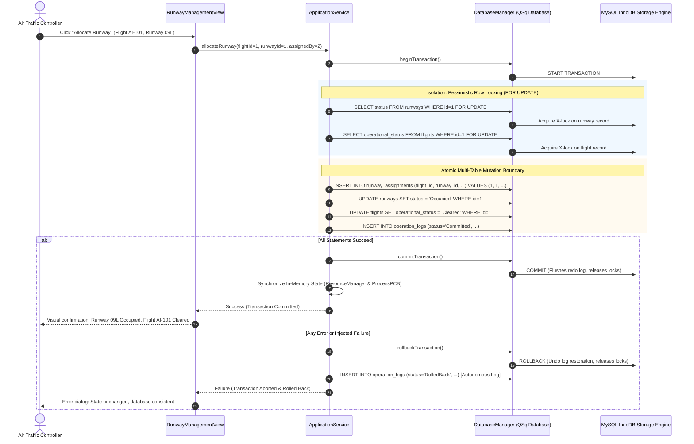

# SmartATC — DBMS Transaction & ACID Demonstration Guide

## 1. Overview & Pedagogical Purpose

In the **Smart Air Traffic Control Management System (SmartATC)**, allocating and releasing airport runways are not isolated memory mutations; they are high-stakes, multi-table database operations that must satisfy the relational **ACID** properties (Atomicity, Consistency, Isolation, Durability). 

An allocation or release involves coordinating state across four database tables:
1. `runways` (Resource registry & operational status: Available, Occupied, Maintenance)
2. `runway_assignments` (Active resource allocations with timestamps)
3. `flights` (Operational flight states: Scheduled, Queued, Cleared, Departed, Landed)
4. `operation_logs` (Audit journal and transactional history)

This guide demonstrates how SmartATC leverages **MySQL 8 (InnoDB engine)** and **Qt SQL (`QSqlDatabase` transactions)** to guarantee zero partial writes, strict concurrency isolation via pessimistic row locks, and deterministic rollbacks under system failure.

---

## 2. Transaction Architecture & Boundaries

All transactional logic resides in the service layer (`ApplicationService`), executing via the database singleton `DatabaseManager`.



---

## 3. Demonstration Scenario 1: Successful Atomic COMMIT

### 3.1 Objective
Demonstrate that allocating an available runway (`09L`) to an eligible flight (`AI-101`) atomically executes all four database mutations and writes an audit log within the same transaction boundary.

### 3.2 Pre-State SQL Inspection
Run the following SQL script to inspect initial database state before allocation:

```sql
-- Step 1: Verify Pre-Allocation Database State
SELECT id, runway_code, status, runway_type FROM runways WHERE id = 1;
SELECT id, flight_number, operational_status FROM flights WHERE id = 1;
SELECT id, flight_id, runway_id, status, assigned_at, released_at 
FROM runway_assignments WHERE runway_id = 1 AND status = 'Active';
SELECT id, action, details, transaction_status, created_at 
FROM operation_logs ORDER BY id DESC LIMIT 3;
```

**Expected Pre-State Output:**
| Table | Key Column | Expected Value |
|---|---|---|
| `runways` | `status` | `'Available'` |
| `flights` | `operational_status` | `'Scheduled'` (or `'Queued'`) |
| `runway_assignments` | Active rows for `runway_id = 1` | `0 rows` |
| `operation_logs` | Latest records | Prior operations |

### 3.3 GUI Action Steps
1. Log in to SmartATC as `atc_demo` (Password: `ATC@1234`).
2. Navigate to **Runway Management View** (`RunwayManagementView`).
3. In the Runways Table, observe **Runway 09L** showing status `Available` with a green indicator.
4. Click **Allocate Runway** to open the allocation dialog.
5. Select Flight: **AI-101 (Air India, Scheduled)**.
6. Select Runway: **09L (Length: 3660m, Type: Both)**.
7. Click **Confirm Allocation**.

### 3.4 Observed Results in GUI
- A progress indicator flashes briefly indicating transaction execution.
- Status message displays: `Runway 09L allocated to flight AI-101 successfully. Transaction Committed.`
- Runway 09L row in the table immediately updates to status **Occupied** with a red indicator.
- Action button for 09L switches from "Allocate" to "Release".
- In the Transaction Activity / Audit panel, a new entry appears: `ALLOCATE_RUNWAY | Flight AI-101 -> Runway 09L | Status: Committed`.

### 3.5 Post-State SQL Verification
Run the verification query immediately:

```sql
-- Step 2: Verify Post-Allocation Committed State
SELECT id, runway_code, status FROM runways WHERE id = 1;
SELECT id, flight_number, operational_status FROM flights WHERE id = 1;
SELECT id, flight_id, runway_id, status FROM runway_assignments WHERE runway_id = 1 AND status = 'Active';
SELECT action, details, transaction_status FROM operation_logs ORDER BY id DESC LIMIT 1;
```

**Observed Verification Data:**
- `runways.status`: Changed from `'Available'` to `'Occupied'`.
- `flights.operational_status`: Changed from `'Scheduled'` to `'Cleared'`.
- `runway_assignments`: Exactly **one** active record inserted (`flight_id = 1, runway_id = 1, status = 'Active'`).
- `operation_logs`: Logged with `transaction_status = 'Committed'`.

---

## 4. Demonstration Scenario 2: Deterministic ROLLBACK on Contention / Error

### 4.1 Objective
Prove **Atomicity** by demonstrating that if an allocation fails (e.g. runway is already occupied, flight is already cleared, or an unexpected database error occurs midway), **none** of the database mutations persist, and the database remains in its pre-transaction state.

### 4.2 Natural Contention Scenario (Concurrent Double Allocation)
1. In the GUI, with Runway 09L already `Occupied` by Flight AI-101, attempt to allocate Runway 09L to another flight (e.g. `6E-202`).
2. Notice the GUI dialog validates and prevents selection, or if forced via API/Service:
   ```cpp
   // Service layer attempts:
   bool success = appService->allocateRunway(2 /*6E-202*/, 1 /*09L*/, userId);
   ```
3. The SQL transaction executes `SELECT status FROM runways WHERE id = 1 FOR UPDATE`.
4. The service layer detects `status != 'Available'`, sets an error message: `"Runway 09L is currently Occupied and cannot be allocated."`, and immediately triggers `db.rollback()`.

### 4.3 Deterministic Failure Injection Scenario (Midway Simulation)
To prove to an academic examiner that mid-transaction crashes roll back partial statements, SmartATC includes test harness failure injection hooks in `ApplicationService`:

```cpp
// Failure Stage Enum:
// 1: BeforeInsertAssignment
// 2: DuringInsertAssignment
// 3: DuringUpdateRunway
// 4: DuringUpdateFlight
// 5: DuringInsertOperationLog
// 6: DuringCommit
appService->setAllocationFailureStage(ApplicationService::FailureStage::DuringUpdateFlight);
```

#### Step-by-Step Viva Execution:
1. Call the service method or execute the unit test scenario (`tst_database_transactions.cpp`).
2. Attempt allocation of Runway `09R` to Flight `SG-404`.
3. Execution sequence:
   - Statement 1 (`INSERT INTO runway_assignments`) executes successfully.
   - Statement 2 (`UPDATE runways SET status = 'Occupied'`) executes successfully.
   - Failure injected at Statement 3 (`UPDATE flights`) $\rightarrow$ synthetic error raised.
   - Catch block triggers `DatabaseManager::instance().rollbackTransaction()`.
   - Engine issues MySQL `ROLLBACK`.

#### Verification Query:
```sql
-- Step 3: Verify Zero Partial Writes After Rollback
SELECT id, runway_code, status FROM runways WHERE id = 2;
SELECT id, flight_number, operational_status FROM flights WHERE flight_number = 'SG-404';
SELECT * FROM runway_assignments WHERE runway_id = 2 AND status = 'Active';
SELECT action, details, transaction_status FROM operation_logs ORDER BY id DESC LIMIT 1;
```

**Verification Results:**
- `runways.status`: Remained `'Available'`.
- `flights.operational_status`: Remained `'Scheduled'`.
- `runway_assignments`: **Zero** rows inserted (the inserted assignment was erased by InnoDB undo logs).
- `operation_logs`: Shows an autonomous failure log: `transaction_status = 'RolledBack'`.

---

## 5. Verification of the 4 ACID Properties

| ACID Property | Theoretical Definition | SmartATC Implementation & Demonstration |
|---|---|---|
| **Atomicity** | "All or nothing" — all statements in the transaction boundary commit together or roll back entirely. | Demonstrated via Scenario 2 failure injection: `runway_assignments` insert and `runways` update are completely wiped out when `flights` update fails. No orphaned assignments or phantom status changes exist. |
| **Consistency** | The database transitions from one valid state to another, preserving all schema constraints, foreign keys, and invariants. | Demonstrated via Foreign Keys (`fk_assignment_flight`, `fk_assignment_runway`) and Status ENUMs. If an invalid `flight_id` (e.g., 9999) is passed, MySQL rejects the insert with an FK constraint violation, rolling back the transaction and keeping runway state valid. |
| **Isolation** | Uncommitted transactions are invisible to other transactions; concurrent transactions do not interfere destructively. | Demonstrated via `SELECT ... FOR UPDATE` row-level exclusive locks in InnoDB. When Thread A locks Runway 09L, Thread B attempting to lock 09L blocks at the database level until Thread A commits or rolls back, preventing lost updates and dirty reads. |
| **Durability** | Once committed, changes survive application crashes, power loss, and server restarts. | Demonstrated by committing an allocation in SmartATC, abruptly terminating the `SmartATC.exe` process via Windows Task Manager, restarting the application, and observing that Runway 09L remains `Occupied` with Flight AI-101. |

---

## 6. Examiner Q&A Guide (DBMS Viva)

**Q1: Why did you wrap runway allocation in a database transaction instead of separate queries?**
> **Answer:** Runway allocation requires updating multiple dependent tables (`runway_assignments`, `runways`, `flights`, and `operation_logs`). If the system executed these independently and crashed or encountered a network error between updating the runway and updating the flight, the runway would be marked `Occupied` while the flight remained `Scheduled`, or an assignment record would exist without the runway being locked. Using a transaction guarantees atomicity: all four updates commit or none do.

**Q2: What transaction isolation level does SmartATC use in MySQL?**
> **Answer:** SmartATC runs on MySQL's default `REPEATABLE READ` isolation level on InnoDB. Furthermore, to prevent race conditions during concurrent allocation attempts, we employ explicit pessimistic locking using `SELECT ... FOR UPDATE` on the specific runway and flight rows. This guarantees that two simultaneous transactions cannot read the same runway as `Available` at the same time.

**Q3: How does the application prevent in-memory state and database state from drifting apart?**
> **Answer:** We follow a "Database-First" two-phase commit pattern in our service layer:
> 1. The database transaction is executed and verified first.
> 2. Only if `db.commit()` returns `true` does `ApplicationService` update the in-memory `ResourceManager` and `Flight` objects.
> 3. If the database transaction rolls back, in-memory state is never touched, preventing drift.

**Q4: Where does the audit log get written if the transaction rolls back?**
> **Answer:** Inside the transaction, an operation log record with `transaction_status = 'Committed'` is prepared. If the transaction rolls back, that log is undone along with the mutations. To record the failure, the catch block opens an autonomous log insertion outside the failed transaction boundary, saving an audit trail record with `transaction_status = 'RolledBack'` and the specific failure reason.
