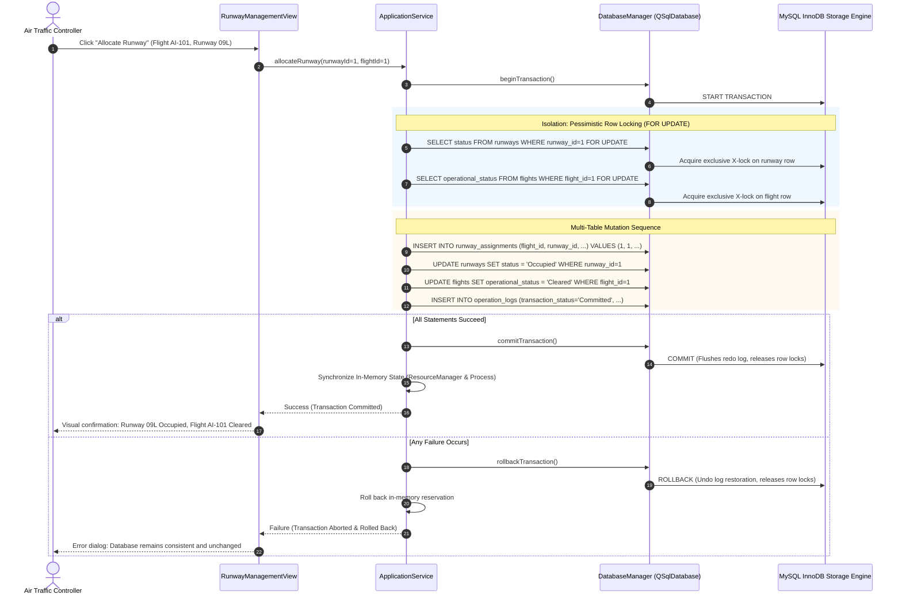

# SmartATC — DBMS Transaction & ACID Demonstration Guide

## 1. Overview & Pedagogical Purpose

In the **Smart Air Traffic Control Management System (SmartATC)**, allocating and releasing airport runways are multi-table database operations that must strictly satisfy the relational **ACID** properties (Atomicity, Consistency, Isolation, Durability). 

An allocation or release coordinates state across four relational database tables:
1. `runways` (Resource registry: `runway_id`, `runway_number`, `runway_type`, `status`)
2. `runway_assignments` (Active resource allocations: `assignment_id`, `flight_id`, `runway_id`, `assigned_by`, `assigned_at`, `released_at`, `status`)
3. `flights` (Flight lifecycle: `flight_id`, `flight_number`, `priority`, `is_emergency`, `operational_status`)
4. `operation_logs` (Audit journal: `log_id`, `user_id`, `operation_type`, `flight_id`, `runway_id`, `transaction_status`, `message`, `created_at`)

This guide explains how SmartATC leverages **MySQL 8 (InnoDB storage engine)** and **Qt SQL (`QSqlDatabase` transactions)** to guarantee zero partial writes, strict concurrency isolation via pessimistic row locks, and deterministic rollbacks under system failure.

---

## 2. Transaction Architecture & Boundaries

All transactional logic resides in the service layer (`ApplicationService`), executing via the database singleton `DatabaseManager`.



---

## 3. Demonstration Scenario 1: Successful Atomic COMMIT

### 3.1 Objective
Demonstrate that allocating an available runway (`09L`, ID: 1) to an eligible flight (`AI-101`, ID: 1) atomically executes all four database mutations and writes an audit log within the same transaction boundary.

### 3.2 Pre-State SQL Inspection
Run the following SQL script to inspect initial database state before allocation:

```sql
-- Step 1: Verify Pre-Allocation Database State
SELECT runway_id, runway_number, status, runway_type FROM runways WHERE runway_id = 1;
SELECT flight_id, flight_number, operational_status FROM flights WHERE flight_id = 1;
SELECT assignment_id, flight_id, runway_id, status, assigned_at, released_at 
FROM runway_assignments WHERE runway_id = 1 AND status = 'Active';
SELECT log_id, operation_type, transaction_status, message, created_at 
FROM operation_logs ORDER BY log_id DESC LIMIT 3;
```

**Expected Pre-State Output:**
| Table | Key Column | Expected Value |
|---|---|---|
| `runways` | `status` | `'Available'` |
| `flights` | `operational_status` | `'Scheduled'` |
| `runway_assignments` | Active rows for `runway_id = 1` | `0 rows` |
| `operation_logs` | Latest records | Prior operations |

### 3.3 GUI Action Steps
1. Log in to SmartATC as `atc_demo`.
2. Navigate to **Runway Management View** (`RunwayManagementView`).
3. In the Runways Table, observe **Runway 09L** showing status `Available`.
4. Click **Allocate Runway** to open the allocation dialog.
5. Select Flight: **AI-101 (Air India, Scheduled)**.
6. Select Runway: **09L (Length: 3660m, Type: Both)**.
7. Click **Confirm Allocation**.

### 3.4 Observed Results in GUI
- Status message displays: `Runway 09L allocated to flight AI-101 successfully. Transaction Committed.`
- Runway 09L row in the table immediately updates to status **Occupied**.
- Action button for 09L switches from "Allocate" to "Release".
- In the Transaction Activity / Audit panel, a new entry appears: `RUNWAY_ASSIGN | Flight AI-101 -> Runway 09L | Status: Committed`.

### 3.5 Post-State SQL Verification
Run the verification query immediately:

```sql
-- Step 2: Verify Post-Allocation Committed State
SELECT runway_id, runway_number, status FROM runways WHERE runway_id = 1;
SELECT flight_id, flight_number, operational_status FROM flights WHERE flight_id = 1;
SELECT assignment_id, flight_id, runway_id, status FROM runway_assignments WHERE runway_id = 1 AND status = 'Active';
SELECT log_id, operation_type, transaction_status, message FROM operation_logs ORDER BY log_id DESC LIMIT 1;
```

**Observed Verification Data:**
- `runways.status`: Changed from `'Available'` to `'Occupied'`.
- `flights.operational_status`: Changed from `'Scheduled'` to `'Cleared'`.
- `runway_assignments`: Exactly **one** active record inserted (`flight_id = 1, runway_id = 1, status = 'Active'`).
- `operation_logs`: Logged with `transaction_status = 'Committed'`.

---

## 4. Demonstration Scenario 2: Validation Rejection vs. Genuine Transaction ROLLBACK

A critical academic distinction must be made between:
1. **Pre-Mutation Validation Rejection:** An invalid request rejected before write mutations occur.
2. **Genuine Transaction Rollback:** A failure occurring *after* one or more mutations have already executed in the active transaction, proving that InnoDB undo logs roll back the partial writes.

### 4.1 Type A: Pre-Mutation Validation Rejection (Occupied Runway Conflict)
1. With Runway 09L already `Occupied` by Flight AI-101, attempt to allocate Runway 09L to another flight (e.g. `6E-202`).
2. The transaction starts and executes:
   ```sql
   SELECT runway_number, runway_type, status FROM runways WHERE runway_id = 1 FOR UPDATE;
   ```
3. `ApplicationService` reads `status == 'Occupied'`. Because the runway is not available, the service does not execute any `INSERT` or `UPDATE` mutations; it issues `db.rollback()` and returns `Models::AllocationResult::RunwayUnavailable`.
4. The database remains completely consistent.

### 4.2 Type B: Genuine Transaction Rollback via Failure Injection
To prove that **partial database writes are rolled back**, SmartATC implements deterministic failure-injection hooks in `ApplicationService`:

```cpp
enum class AllocationFailureStage {
    None,
    BeforeInsertAssignment,
    DuringInsertAssignment,
    DuringUpdateRunway,
    DuringUpdateFlight,
    DuringInsertOperationLog,
    DuringCommit
};
```

#### Step-by-Step Execution of Genuine Rollback:
1. In test code or diagnostics (as executed in automated test suite `TestACIDProperties` and `TestDatabaseTransactions`):
   ```cpp
   appService->setAllocationFailureStage(
       ApplicationService::AllocationFailureStage::DuringUpdateFlight);
   ```
2. The controller attempts allocation of Runway `09R` (runway_id: 2) to Flight `SG-404` (flight_id: 4).
3. **Execution Sequence inside MySQL:**
   - `START TRANSACTION` is issued.
   - Row locks acquired on `runways` and `flights` (`FOR UPDATE`).
   - Mutation 1 executes: `INSERT INTO runway_assignments ...` $\to$ **Assignment row created in MySQL buffer.**
   - Mutation 2 executes: `UPDATE runways SET status = 'Occupied' WHERE runway_id = 2;` $\to$ **Runway row modified in MySQL buffer.**
   - Mutation 3 reaches `DuringUpdateFlight` $\to$ **Synthetic failure triggered.**
   - Exception/error handler executes `db.rollback()`.
   - MySQL InnoDB rolls back all intermediate modifications using undo logs.
4. **Post-Rollback Verification Query:**
   ```sql
   -- Verify that NO partial records remain in the database:
   SELECT runway_id, runway_number, status FROM runways WHERE runway_id = 2;
   -- Expected: status remains 'Available' (UPDATE rolled back)

   SELECT * FROM runway_assignments WHERE runway_id = 2 AND status = 'Active';
   -- Expected: 0 rows (INSERT rolled back)

   SELECT flight_id, flight_number, operational_status FROM flights WHERE flight_id = 4;
   -- Expected: operational_status remains 'Scheduled'
   ```
5. **Academic Proof:** If transactions were not used, Runway 09R would have been left permanently locked as `Occupied` without a corresponding cleared flight. The rollback guarantees **zero partial writes**.

---

## 5. Precise Verification of the 4 ACID Properties

| ACID Property | Theoretical Definition | SmartATC Implementation & Exact Scope of Verification |
|---|---|---|
| **Atomicity** | "All or nothing" — all statements within the transaction boundary commit together or roll back entirely. | **Verified via Failure Injection (Type B):** As proven in `TestACIDProperties::testAtomicityRollbackOnMidwayFailure()`, injecting a failure during `DuringUpdateFlight` or `DuringCommit` completely rolls back the preceding `runway_assignments` insert and `runways` status update. Zero orphan rows exist. |
| **Consistency** | The database transitions from one valid state to another, preserving all relational invariants, schemas, and foreign keys. | **Verified via Schema Constraints & Service Invariants:** Foreign keys (`fk_ra_flight_id`, `fk_ra_runway_id`), check constraints (`chk_flights_priority`), and status enums reject invalid state transitions. If an invalid ID is supplied, the foreign key constraint aborts the transaction cleanly. |
| **Isolation** | Concurrent transactions execute without destructive interference or dirty reads. | **Verified via Pessimistic Row Locking:** SmartATC runs on MySQL's default `REPEATABLE READ` transaction isolation level. Concurrency is strictly serialized using explicit `SELECT ... FOR UPDATE` row locks on the target runway and flight. Concurrent allocation attempts on the same runway are forced to wait for lock resolution. |
| **Durability** | Committed data survives system stops, restarts, and crashes. | **Verified via Application Restart:** Once a runway allocation commits, the `SmartATC.exe` application process was closed, terminated, and relaunched. Upon reconnection, MySQL returned the committed status (`Occupied`), confirming that InnoDB write-ahead redo logs committed the data to non-volatile disk. *(Note: This verifies application-level persistence across restarts. Server crash-recovery relies on InnoDB redo logs and doublewrite buffer).* |

---

## 6. Examiner Q&A Guide (DBMS Viva)

**Q1: Why did you wrap runway allocation in a database transaction instead of separate queries?**
> **Answer:** Runway allocation involves updating three dependent entities (`runway_assignments`, `runways`, and `flights`) plus an audit log in `operation_logs`. If executed as isolated statements and a failure or network drop occurred midway, the system would enter an inconsistent state (e.g., a runway marked Occupied with no active assignment). The transaction guarantees atomicity: all updates commit together or all roll back.

**Q2: What transaction isolation level does SmartATC use in MySQL?**
> **Answer:** SmartATC utilizes MySQL InnoDB's default `REPEATABLE READ` isolation level. Furthermore, because multiple controllers could attempt simultaneous allocation of the same runway, we enforce explicit pessimistic concurrency control using `SELECT ... FOR UPDATE` row locks. This acquires exclusive X-locks and serializes competing transactions at the database level.

**Q3: What is the difference between a validation rejection and a transaction rollback?**
> **Answer:** A validation rejection occurs before any state-modifying mutations take place (e.g., detecting that a runway is in Maintenance or already Occupied). A transaction rollback occurs after one or more mutations have already been executed within an open transaction; when a subsequent statement fails, the engine issues `ROLLBACK`, triggering InnoDB undo logs to reverse the earlier writes and restore the pre-transaction state.

**Q4: How does the application prevent in-memory state and database state from drifting apart?**
> **Answer:** We enforce a two-phase synchronization pattern in `ApplicationService`:
> 1. The MySQL database transaction is executed and committed first.
> 2. Only after `db.commit()` returns `true` does the service notify `ResourceManager` to confirm the in-memory state.
> 3. If `db.commit()` fails or any statement triggers a rollback, `m_resourceManager->rollbackAllocationUnlocked()` is invoked, ensuring that in-memory reservations are cleared and memory matches MySQL.
