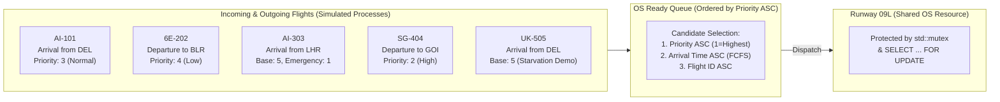

# Demonstration Data & Master Scenario Specification

## 1. Scenario Context: Airport Operational Overview

The SmartATC demonstration scenario is set at a major international hub—**Chhatrapati Shivaji Maharaj International Airport (BOM / VABB)**.

During the morning traffic peak, the air traffic control tower manages multiple arriving and departing aircraft while coordinating runway surface availability, mechanical maintenance, in-flight emergencies, and ground resource contention.

This real-world environment provides the backdrop for demonstrating:
- Process creation, scheduling queues, and deterministic priority dispatch.
- Emergency priority overrides and starvation prevention through priority aging.
- Hardware mutual exclusion on shared runways using `std::mutex` and multithreading.
- Multi-statement ACID database transactions with row-level pessimistic locking in MySQL InnoDB.
- Operational monitoring and audit logging on a real-time dashboard.

---

## 2. User Accounts & Role Permissions

The demonstration utilizes the three pre-provisioned system accounts defined in `sql/seed.sql` and verified in `TestAuthAndRBAC.cpp`:

| Account Username | Display Name | Assigned Role | Primary Operational Capabilities |
|:---|:---|:---|:---|
| **`admin_demo`** | System Administrator | **Admin** | Full system administration, user account management, fleet registration, transaction oversight, system configuration. |
| **`atc_demo`** | Radar Controller Alpha | **ATC** | Air traffic control, flight scheduling, declaring/clearing in-flight emergencies, process dispatching, runway allocation. |
| **`operator_demo`** | Ground Marshall Bravo | **Airport Operator** | Airfield infrastructure maintenance, runway status toggle (`Available` / `Maintenance`), aircraft fleet servicing, contention demo. |

> [!NOTE]
> **Credential Security:**  
> Passwords in the database are stored as SHA-256 digests. For oral evaluation and presentation safety, credentials should be configured locally in `db.conf` and verified before beginning the demonstration. Plaintext passwords must never be committed to Git.

---

## 3. Physical Runway Infrastructure

The demonstration uses three distinct physical runway assets representing exclusive shared OS resources:

| Runway ID | Runway Number | Operational Type | Initial Demo Status | Operational Role in Scenario |
|:---:|:---:|:---:|:---:|:---|
| **1** | **`09L`** | **`Both`** | **`Available`** | Primary instrument runway. Used for the main allocation, mutual exclusion contention, and MySQL transaction demonstration. |
| **2** | **`09R`** | **`Takeoff`** | **`Available`** | Dedicated departure strip. Demonstrates operational type compatibility checking (rejects arrivals). |
| **3** | **`27`** | **`Landing`** | **`Maintenance`** | Cross-wind strip under active pavement maintenance. Demonstrates resource offline gating and rejection of allocation requests. |

---

## 4. Aircraft Fleet Inventory

The airport fleet registry maintains four representative commercial airframes:

| Aircraft ID | Tail Registration | Aircraft Type | Passenger Capacity | Initial Status | Operational Assignment |
|:---:|:---|:---|:---:|:---:|:---|
| **1** | **`VT-AT1`** | Boeing 737-800 | 189 | `Active` | Assigned to flight `AI-101` and `UK-505`. |
| **2** | **`VT-AT2`** | Airbus A320neo | 180 | `Active` | Assigned to flight `6E-202`. |
| **3** | **`VT-AT3`** | Boeing 777-300ER | 396 | `Active` | Assigned to long-haul arrival `AI-303`. |
| **4** | **`VT-AT4`** | Bombardier Q400 | 78 | `Maintenance` | Regional turboprop undergoing avionics inspection. |

---

## 5. Master Scenario Flight Operations

The scenario tracks five core fictional commercial flights that compete for scheduling order and runway resources:

### Detailed Flight Specifications:

| Flight Number | Flight ID | Airline | Route | Flight Type | Scheduled Time | Base Priority | Initial Status | Scenario Narrative |
|:---|:---:|:---|:---:|:---:|:---:|:---:|:---:|:---|
| **`AI-101`** | **1** | Air India | DEL $\to$ BOM | **Arrival** | 10:00:00 | **3** (Normal) | `Scheduled` | Standard scheduled domestic passenger arrival. Initial candidate in the Ready Queue. |
| **`6E-202`** | **2** | IndiGo | BOM $\to$ BLR | **Departure** | 10:15:00 | **4** (Low) | `Scheduled` | Short-haul departure. Lower priority than AI-101; waits in Ready Queue. |
| **`AI-303`** | **3** | Air India | LHR $\to$ BOM | **Arrival** | 10:30:00 | **5** (Lowest) | `Scheduled` | Long-haul flight from London. Initially lowest base priority (5). Declares fuel emergency live during the demo, jumping to Priority 1! |
| **`SG-404`** | **4** | SpiceJet | BOM $\to$ GOI | **Departure** | 10:45:00 | **2** (High) | `Scheduled` | High-priority commercial flight demonstrating tie-breaking and priority precedence. |
| **`UK-505`** | **5** | Vistara | DEL $\to$ BOM | **Arrival** | 08:30:00 | **5** (Lowest) | `Scheduled` | Low-priority flight used in the Starvation Demonstration tab to illustrate aging progression from Priority 5 to Priority 1. |

---

## 6. Simulated Process Control Block (PCB) Baseline State

When enqueued in `scheduling_queue`, each flight operation initializes its corresponding simulated Process Control Block:

| Flight ID | Simulated PID | Base Priority | Effective Priority | Service Time ($BT$) | Ready Since | Initial State |
|:---:|:---:|:---:|:---:|:---:|:---:|:---:|
| **1** (`AI-101`) | 1 | 3 | 3 | 60s | $t = 0\text{s}$ | `Ready` |
| **2** (`6E-202`) | 2 | 4 | 4 | 60s | $t = 0\text{s}$ | `Ready` |
| **3** (`AI-303`) | 3 | 5 | 5 $\to$ **1** (Emg) | 90s | $t = 10\text{s}$ | `Ready` |
| **4** (`SG-404`) | 4 | 2 | 2 | 60s | $t = 15\text{s}$ | `Ready` |
| **5** (`UK-505`) | 5 | 5 | 5 $\to$ 4 $\to$ 3 $\to$ 2 $\to$ 1 | 60s | $t = 0\text{s}$ | `Ready` (Starvation Test) |

---

## 7. Data Safety and Invariant Rules

To ensure predictable demonstration execution without corrupting production data:
1. **No Duplicate Active Assignments:** A runway may have at most one active record in `runway_assignments` where `status = 'Active'`.
2. **Terminal Flight Gating:** Flights in `Landed`, `Departed`, or `Cancelled` states cannot acquire runways.
3. **Foreign Key Integrity:** All test records strictly reference existing `aircraft_id`, `flight_id`, `runway_id`, and `user_id` values.
4. **Referential Preservation:** All operations use soft status updates (`Cancelled`, `Released`) rather than hard `DELETE` or `TRUNCATE` statements.
5. **Reversibility:** Every demonstrated mutation can be inspected and cleanly restored using the documented procedures in `DEMO_RESET_GUIDE.md`.
