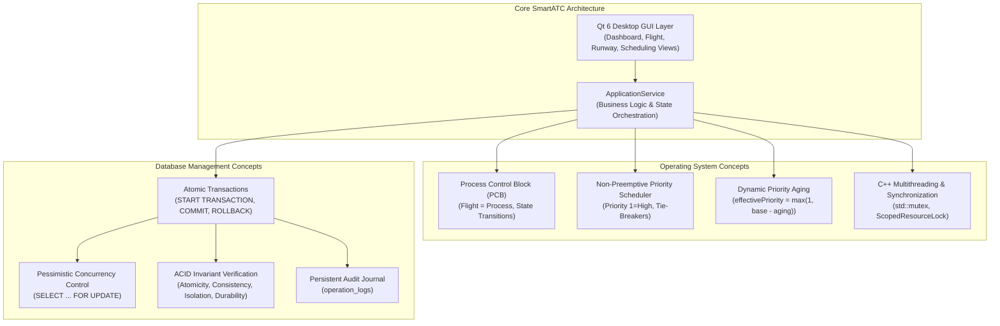

# SmartATC — Master Demonstration & Evaluation Guide

## 1. Executive Summary

The **Smart Air Traffic Control Management System (SmartATC)** is an educational, production-structured desktop application developed for the B.Tech final-year capstone project. 

The system demonstrates advanced concepts from **Operating Systems (OS)** and **Database Management Systems (DBMS)** through an airport runway management and resource allocation simulation set at **Chhatrapati Shivaji Maharaj International Airport (BOM / VABB), Mumbai**.

This master guide binds the entire demonstration documentation suite into a unified runbook for students, evaluators, and examiners.

---

## 2. Demonstration Suite Navigation

The `docs/demo/` directory provides complete documentation for the final demonstration:

```
SmartATC/docs/demo/
├── DEMONSTRATION_GUIDE.md      <-- [You are here] Master overview & index
├── DEMONSTRATION_SCRIPT.md     <-- Step-by-step spoken script & 8-phase oral guide (18-20 min)
├── DEMONSTRATION_DATA.md       <-- Concrete BOM fleet, runways, accounts & baseline data
├── OS_CONCEPT_DEMO.md          <-- Deep-dive: PCB, Priority Scheduling, Aging & Mutex demo
├── DBMS_TRANSACTION_DEMO.md    <-- Deep-dive: MySQL Transactions, Row Locks & ACID properties
├── DEMO_RESET_GUIDE.md         <-- Safe, idempotent reset procedures & SQL scripts
├── demo_reset.sql              <-- Executable non-destructive reset transaction script
└── DEMONSTRATION_CHECKLIST.md  <-- 38-point pre-flight & verification sign-off audit
```

### Document Purpose Quick Reference

| Document | Primary Audience | When to Use |
|---|---|---|
| [DEMONSTRATION_SCRIPT.md](file:///d:/Projects/Airport%20Runway%20Manager%20&Resource%20Allocation/SmartATC/docs/demo/DEMONSTRATION_SCRIPT.md) | Presenters | During the live presentation; contains exact lines to speak, actions to perform, and what to show. |
| [DEMONSTRATION_DATA.md](file:///d:/Projects/Airport%20Runway%20Manager%20&Resource%20Allocation/SmartATC/docs/demo/DEMONSTRATION_DATA.md) | Presenters & Evaluators | Before the presentation; defines all demo flight numbers, credentials, and runway IDs. |
| [OS_CONCEPT_DEMO.md](file:///d:/Projects/Airport%20Runway%20Manager%20&Resource%20Allocation/SmartATC/docs/demo/OS_CONCEPT_DEMO.md) | Technical Examiners | During the OS portion of the viva; proves PCB state transitions, aging formulas, and mutex locking. |
| [DBMS_TRANSACTION_DEMO.md](file:///d:/Projects/Airport%20Runway%20Manager%20&Resource%20Allocation/SmartATC/docs/demo/DBMS_TRANSACTION_DEMO.md) | Technical Examiners | During the DBMS portion of the viva; proves atomic commit, rollback, row locks, and ACID properties. |
| [DEMO_RESET_GUIDE.md](file:///d:/Projects/Airport%20Runway%20Manager%20&Resource%20Allocation/SmartATC/docs/demo/DEMO_RESET_GUIDE.md) | Lab Technicians / Presenters | Before each dry run and between examination panels to reset state without wiping data. |
| [DEMONSTRATION_CHECKLIST.md](file:///d:/Projects/Airport%20Runway%20Manager%20&Resource%20Allocation/SmartATC/docs/demo/DEMONSTRATION_CHECKLIST.md) | Internal Evaluators | 30 minutes before presentation; comprehensive pre-flight verification checklist. |

---

## 3. Environment & Hardware Prerequisites

### 3.1 Software Requirements
- **Operating System:** Windows 10 / 11 (x64)
- **Compiler:** MSVC 2019 / 2022 or GCC / MinGW 11.2+ (C++17 standard)
- **Framework:** Qt 6.5.0 or later (Qt Widgets, Qt Core, Qt Gui, Qt Sql)
- **Database Engine:** MySQL Server 8.0+ running on `127.0.0.1:3306` with InnoDB engine
- **Qt MySQL Driver:** `qsqlmysql.dll` loaded and accessible in Qt plugins path

### 3.2 Display & Projection Setup
- Recommended screen resolution: **1920 x 1080 (1080p)** or **1366 x 768** minimum.
- Font scaling: 100% or 125% for high-visibility UI presentation.

---

## 4. Key Academic Concepts Demonstrated



---

## 5. Master Timing & Delivery Plan (20-Minute Viva)

| Phase | Section | Duration | Key Visual / Action | Key Takeaway for Examiner |
|---|---|---|---|---|
| **Phase 1** | System Overview & Architecture | 2 min | Title slide & system architecture diagram | Bridges aviation operations with OS and DBMS paradigms. |
| **Phase 2** | Authentication & RBAC | 2 min | Log in as `operator_demo`, then `atc_demo` | Enforces least-privilege role boundaries; SHA-256 hashed credentials. |
| **Phase 3** | Flight & Aircraft Management | 2 min | Flight Table showing BOM demo fleet | Demonstrates entity relationships and baseline process states. |
| **Phase 4** | OS Scheduling & Emergency Handling | 4 min | Step Ready Queue; Declare emergency on AI-303 | Priority 1 = highest; tie-breakers; non-preemptive guarantee verified. |
| **Phase 5** | Priority Aging & Starvation Demo | 2 min | Starvation tab: simulate inflow; enable aging | Demonstrates starvation vulnerability and dynamic mathematical cure. |
| **Phase 6** | Critical Sections & Multithreading | 3 min | Concurrent Allocation Demo with 2 threads | `std::mutex` and RAII lock prevent double-allocation race conditions. |
| **Phase 7** | MySQL Transactions & ACID Proof | 3 min | Runway allocation; failure injection rollback | Multi-table atomic commit; zero partial writes verified in DB. |
| **Phase 8** | Dashboard & Evaluation Conclusion | 2 min | Live Dashboard overview; metrics review | Real-time monitoring driven entirely by live MySQL/app state. |

---

## 6. Risk Contingency & Fallback Matrix

| Potential Issue During Demo | Root Cause | Immediate Contingency Procedure |
|---|---|---|
| **MySQL connection drops** | Service stopped or port conflict | Run `net start MySQL80` in PowerShell (Admin), then press `Ctrl+R` in SmartATC. |
| **Data in unexpected state** | Previous test left active assignments | Run `SmartATC/docs/demo/demo_reset.sql` via MySQL CLI; executes in < 0.2s. |
| **Projector cuts off UI edges** | Low resolution on projector | Press `F11` (or maximize window) to trigger responsive Qt layouts. |
| **Concurrent demo finishes too fast** | Microsecond thread execution | Use the built-in artificial delay slider in `ConcurrentAllocationDemo` (set to 200ms). |
| **Examiner requests raw DB proof** | Wants to verify that UI is not faking data | Open MySQL Workbench or Windows Terminal side-by-side with SmartATC and run live queries. |

---

## 7. Post-Demonstration Clean Up

Immediately following the examination session:
1. Close `SmartATC.exe`.
2. Execute the non-destructive reset script:
   ```powershell
   mysql -u root -p smartatc -e "source SmartATC/docs/demo/demo_reset.sql"
   ```
3. Verify with `SELECT COUNT(*) FROM runway_assignments WHERE status = 'Active';` (Expected: 0).
4. System is cleanly reset and ready for subsequent evaluation panels.
