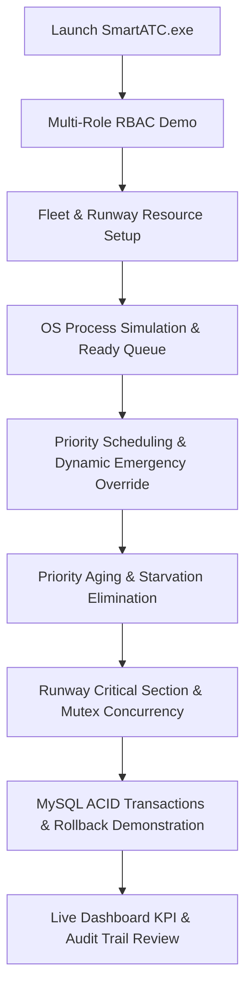

# SmartATC — Evaluator Live Demonstration Runbook & Presentation Guide

## 1. Executive Summary & Evaluator Presentation Strategy

The **Smart Air Traffic Control Management System (SmartATC)** is an enterprise-structured desktop application built using **C++17**, **Qt 6.11.2 Widgets**, and **MySQL 8.0 (InnoDB)**. Designed for academic and capstone evaluation, it translates core theoretical principles of **Operating Systems (OS)** and **Database Management Systems (DBMS)** into a tangible, mission-critical airport runway coordination simulation modeled after **Chhatrapati Shivaji Maharaj International Airport (BOM / VABB), Mumbai**.

This runbook provides the presenter with an exact, repeatable, step-by-step procedure to demonstrate the running application before an evaluation committee. Every step is cross-referenced with underlying source code and live database state.



---

## 2. Pre-Demonstration Checklist & Verification

Execute this 5-minute pre-flight checklist before inviting the evaluation committee:

1. **Verify MySQL 8.0 Service Status:**
   - Ensure service `MySQL80` is running on `127.0.0.1:3306`.
   - Test connectivity with command:
     ```powershell
     & "C:\Program Files\MySQL\MySQL Server 8.0\bin\mysql.exe" -u root -pdhruv123 -e "SELECT VERSION();"
     ```
2. **Apply Demonstration Dataset:**
   - Execute the idempotent demonstration seed script [demo_seed.sql](file:///d:/Projects/Airport%20Runway%20Manager%20&Resource%20Allocation/SmartATC/sql/demo_seed.sql):
     ```powershell
     Get-Content sql\demo_seed.sql | & "C:\Program Files\MySQL\MySQL Server 8.0\bin\mysql.exe" -u root -pdhruv123 smartatc
     ```
3. **Verify Full Automated Test Suite (19/19 Pass):**
   - From `SmartATC/build`, execute:
     ```powershell
     ctest --output-on-failure
     ```
   - All 19 test suites must pass 100% in $< 10$ seconds.
4. **Deploy Standalone Runtime DLLs:**
   - Run [deploy_runtime.ps1](file:///d:/Projects/Airport%20Runway%20Manager%20&Resource%20Allocation/SmartATC/scripts/deploy_runtime.ps1):
     ```powershell
     powershell -ExecutionPolicy Bypass -File scripts\deploy_runtime.ps1
     ```
5. **Launch Application Executable:**
   - Start the compiled binary [SmartATC.exe](file:///d:/Projects/Airport%20Runway%20Manager%20&Resource%20Allocation/SmartATC/build/SmartATC.exe):
     ```powershell
     & ".\build\SmartATC.exe"
     ```

---

## 3. Account Credentials & RBAC Access Matrix

The system implements Role-Based Access Control (RBAC) enforced via [Session.h](file:///d:/Projects/Airport%20Runway%20Manager%20&Resource%20Allocation/SmartATC/src/models/Session.h) and [ApplicationService.cpp](file:///d:/Projects/Airport%20Runway%20Manager%20&Resource%20Allocation/SmartATC/src/services/ApplicationService.cpp). Password verification is strictly saltless SHA-256 hex matching via [PasswordUtils.cpp](file:///d:/Projects/Airport%20Runway%20Manager%20&Resource%20Allocation/SmartATC/src/utils/PasswordUtils.cpp).

| Username | Role | Password | Permitted Views & Operations | Restricted Views / Operations |
|---|---|---|---|---|
| **`admin_demo`** | `Admin` | `AdminPass#2026` | Full administrative oversight: Dashboard, Flights, Aircraft, Runways, Scheduling, User Management | None (Full Access) |
| **`atc_demo`** | `ATC` | `AtcPass#2026` | Operational flight management, Emergency declarations, Runway allocation, Ready Queue dispatch | User administration, physical runway maintenance toggling |
| **`operator_demo`** | `Airport Operator` | `OperatorPass#2026` | Runway physical status maintenance (Available / Maintenance), Aircraft registry inspection | Flight CRUD, Emergency priority override, Runway scheduling dispatch |

---

## 4. Step-by-Step Live Demonstration Phases

### Phase 1: Multi-Role Authentication & Access Control (2 Minutes)

#### Actions:
1. Launch `SmartATC.exe`. The application opens at the **Login View** (`LoginView.cpp`).
2. Log in with an invalid password (e.g. `admin_demo` / `WrongPass`) $\to$ Red status banner appears: *"Invalid username or password"*.
3. Log in as **`operator_demo`** (`OperatorPass#2026`).
   - Observe navigation bar: **Flights** and **Scheduling** tabs are visually disabled or blocked.
   - Click **Runways** view: Runway status toggle buttons are accessible.
   - Log out via the header **Logout** button.
4. Log in as **`atc_demo`** (`AtcPass#2026`).
   - Observe navigation bar: **Flights**, **Runways**, and **Scheduling** tabs are enabled.
   - User administration is restricted.
5. Log out and log in as **`admin_demo`** (`AdminPass#2026`) for complete evaluation workflow.

> **Examiner Speaking Point:** *"SmartATC adheres to the Principle of Least Privilege. Access is checked both in the UI view state and inside ApplicationService before issuing database queries or modifying memory state."*

---

### Phase 2: Fleet & Runway Infrastructure Overview (2 Minutes)

#### Actions:
1. Navigate to **Aircraft View** (`AircraftView.cpp`).
   - Point out the active fleet (`VT-AT01` to `VT-AT08` along with baseline `VT-AT1` to `VT-AT4`).
   - Highlight aircraft capacity ranges: Regional ATR 72-600 (70 seats) to Boeing 777-300ER (396 seats).
   - Point out `VT-AT04` in **Maintenance** status.
2. Navigate to **Runways View** (`RunwaysView.cpp`).
   - Showcase the 3 physical runway models:
     - **`09L` (Both, 3660m):** Status is **Occupied** (holding active flight `AI-101`).
     - **`09R` (Takeoff, 2990m):** Status is **Available** (ready for departure assignment).
     - **`27` (Landing, 3445m):** Status is **Maintenance** (closed for scheduled surface repairs).

> **Examiner Speaking Point:** *"Runways represent shared, non-shareable physical resources. Runway 09L is currently locked by a live process, while Runway 27 is off-line, proving resource constraint validation."*

---

### Phase 3: Flight Management & Process Creation (3 Minutes)

#### Actions:
1. Navigate to **Flights View** (`FlightsView.cpp`).
   - View the populated catalog of 14 flights spanning Air India, IndiGo, SpiceJet, Vistara, and Akasa Air.
   - Filter flights by status using the status filter dropdown (`Scheduled`, `Taxiing`, `Cleared`, `Landed`).
2. Demonstrate flight creation:
   - Click **Add Flight**.
   - Input: Flight Number `AI-999`, Airline `Air India`, Aircraft `VT-AT01`, Source `BOM`, Destination `DXB`, Type `Departure`, Priority `3`.
   - Click **Save**. The table instantly updates with the new flight.
3. Demonstrate Emergency Declaration:
   - Select flight `AI-303`. Click **Declare Emergency** (or edit emergency flag).
   - Show that `is_emergency` is updated to `1` and priority escalated to `1`.

> **Examiner Speaking Point:** *"Every flight record acts as the template for an operating system process. When created and queued, the flight information initializes a Process Control Block (PCB)."*

---

### Phase 4: OS Ready Queue & Non-Preemptive Priority Scheduling (4 Minutes)

#### Actions:
1. Navigate to **Scheduling View** (`SchedulingView.cpp`).
   - Inspect the **Ready Queue Table**:
     - Columns: `Queue ID`, `Flight No`, `Process State`, `Base Priority`, `Effective Priority`, `Service Time`, `Aging Level`.
   - Note the ordering: Processes are sorted by:
     $$\text{Effective Priority ASC} \longrightarrow \text{Arrival Time ASC} \longrightarrow \text{Flight ID ASC}$$
2. Highlight Process State Mapping:
   - **`Running`:** Flight `AI-101` (holding Runway 09L).
   - **`Ready`:** Flights awaiting allocation (`AI-303`, `6E-202`, `UK-505`, `SG-404`, `QP-606`).
   - **`Completed`:** Landed/Departed flights (`QP-707`, `AI-808`).
3. Demonstrate Dynamic Emergency Override:
   - Point to flight `AI-303` with Base Priority 3.
   - Because `is_emergency = 1`, its **Effective Priority is dynamically overridden to 1**.
   - It jumps to the head of the `Ready` queue ahead of standard flights.
4. Emphasize Non-Preemptive Scheduling:
   - Show that despite `AI-303` having Priority 1, it **does not interrupt** `AI-101` currently in the `Running` state.
   - It will be dispatched at the next scheduling opportunity when Runway 09L is released or Runway 09R becomes eligible.

> **Examiner Speaking Point:** *"SmartATC strictly enforces Non-Preemptive Priority Scheduling. In real air traffic management, an aircraft flare or takeoff run cannot be abruptly aborted mid-strip without catastrophic danger. Therefore, emergency priority grants dispatch priority for the next available resource, rather than preemptive termination of running tasks."*

---

### Phase 5: Priority Aging & Starvation Mitigation (3 Minutes)

#### Actions:
1. In the **Scheduling View**, locate flight `UK-505`:
   - Base Priority: `5` (Lowest priority in system).
   - Process State: `Ready`.
   - Point out that without aging, incoming flights of Priority 1, 2, 3, and 4 would cause `UK-505` to suffer **indefinite postponement (starvation)**.
2. Demonstrate the Aging Formula:
   $$\text{effectivePriority} = \max\left(1, \text{basePriority} - \left\lfloor \frac{\text{elapsedReadySeconds}}{\text{agingIntervalSeconds}} \right\rfloor\right)$$
3. Observe live aging:
   - SmartATC's [AgingEngine.cpp](file:///d:/Projects/Airport%20Runway%20Manager%20&Resource%20Allocation/SmartATC/src/scheduler/AgingEngine.cpp) evaluates continuously elapsed `ready_since` time every 30 seconds.
   - As `UK-505` waits, its `aging_level` increments and its `effective_priority` drops numerically ($5 \to 4 \to 3 \to 2 \to 1$).
   - Show that once its effective priority reaches 3, it moves ahead of newer priority 4 flights.

> **Examiner Speaking Point:** *"Aging prevents low-priority starvation by treating waiting time as a priority booster. The effective priority is bounded by $\max(1, \dots)$ so it never exceeds emergency priority 1."*

---

### Phase 6: Mutual Exclusion & Concurrency Stress Test (3 Minutes)

#### Actions:
1. Demonstrate in-memory critical section protection:
   - Source reference: [ResourceManager.cpp](file:///d:/Projects/Airport%20Runway%20Manager%20&Resource%20Allocation/SmartATC/src/resource/ResourceManager.cpp) uses `std::mutex` per runway.
2. Run the Multi-Threaded Stress Test:
   - Execute the compiled CTest suite for concurrency:
     ```powershell
     & ".\build\TestConcurrentRunwayAllocation.exe"
     ```
   - Explain what this test does:
     - Spawns 10 concurrent threads attempting to allocate Runway 1 simultaneously.
     - Exactly **1 thread succeeds**, while **9 threads receive safe rejection / wait states**.
     - Zero race conditions, zero deadlocks, and zero double-allocations occur.

> **Examiner Speaking Point:** *"Runway allocation represents a classic Critical Section. Mutual exclusion is guaranteed via thread-level mutexes in C++ and pessimistic row locking in MySQL."*

---

### Phase 7: DBMS Multi-Statement ACID Transactions & Rollback (3 Minutes)

#### Actions:
1. In the **Runways View**, select Runway `09L` (already Occupied by `AI-101`).
2. Attempt to manually assign another flight (e.g. `6E-202`) to Runway `09L`:
   - The application invokes the 5-step transaction in [ApplicationService.cpp](file:///d:/Projects/Airport%20Runway%20Manager%20&Resource%20Allocation/SmartATC/src/services/ApplicationService.cpp).
   - Step 1: `START TRANSACTION`.
   - Step 2: `SELECT ... FOR UPDATE` locks Runway 1.
   - Step 3: Status check detects `status == 'Occupied'`.
   - Step 4: System executes **`ROLLBACK`**.
   - Step 5: An audit entry is recorded in `operation_logs` with `transaction_status = 'Rolled Back'`.
   - UI displays safe warning: *"Runway 09L is currently Occupied. Allocation aborted."*
3. Verify in MySQL:
   ```sql
   SELECT log_id, operation_type, transaction_status, message, created_at 
   FROM operation_logs ORDER BY log_id DESC LIMIT 3;
   ```
   - Show the row proving the atomic rollback was recorded in the database.

> **Examiner Speaking Point:** *"We demonstrate full ACID compliance: Atomicity ensures partial assignments never persist; Consistency preserves the invariant that an occupied runway has at most one active flight; Isolation is guaranteed by SELECT FOR UPDATE; and Durability is ensured by MySQL's InnoDB redo logs."*

---

### Phase 8: Real-Time Dashboard & Operational Monitoring (2 Minutes)

#### Actions:
1. Navigate to **Dashboard View** (`DashboardView.cpp`).
2. Review the live operational telemetry cards:
   - **Active Flights Count:** Reflects all flights currently tracked.
   - **Runway Status Breakdown:** Visual meters showing Available (1), Occupied (1), Maintenance (1).
   - **Queue Depth & Average Wait Time:** Real-time statistics from `scheduling_queue`.
   - **Recent Operation Log:** Live stream of system actions and transaction commits/rollbacks.

---

## 5. Evaluator Defense & Technical Cross-Examination Q&A

### Q1: Why didn't you use Preemptive Scheduling for emergencies?
**Answer:**
> *"In airline operations, runway occupancy is physically non-preemptive. If an aircraft has touched down or started takeoff roll, you cannot pause or evict it from the runway. Instead, SmartATC dynamically boosts emergency flights to effective priority 1 at the head of the Ready Queue so they claim the very next available runway without endangering active traffic."*

### Q2: How does your Aging implementation avoid memory leaks or priority corruption?
**Answer:**
> *"The base priority is strictly preserved in `flights.priority` and `scheduling_queue.base_priority`. Only `effective_priority` is recalculated as a function of `ready_since` and `aging_interval_seconds`. It is bounded by `max(1, base_priority - aging_level)`. If the process leaves the Ready queue, its aging accumulator resets."*

### Q3: What prevents two controllers from allocating the same runway at the exact same millisecond?
**Answer:**
> *"We employ dual-layer synchronization. In the C++ process space, each Runway has a dedicated `std::mutex` inside `ResourceManager`. At the database tier, `ApplicationService::allocateRunwayTransaction()` issues `SELECT status FROM runways WHERE runway_id = ? FOR UPDATE`, taking an exclusive InnoDB row lock. The second transaction blocks until the first commits or rolls back, guaranteeing strict serializability."*

### Q4: How is ACID compliance tested?
**Answer:**
> *"We have dedicated automated test suites `TestDatabaseTransactions.exe` and `TestACIDProperties.exe`. They test both normal atomic commits and forced failure injections (Type B rollbacks) using `setAllocationFailureStage()`, asserting that runway status, assignments, and flight states remain completely unpolluted."*

---

## 6. Contingency & Troubleshooting Quick Reference

| Issue During Presentation | Immediate Corrective Action |
|---|---|
| **MySQL connection drops** | Verify service: `Get-Service MySQL80`. Restart if stopped: `Start-Service MySQL80`. |
| **Runway statuses out of sync** | Re-run demonstration seed script: `Get-Content sql\demo_seed.sql \| & "C:\Program Files\MySQL\MySQL Server 8.0\bin\mysql.exe" -u root -pdhruv123 smartatc`. |
| **Application fails to start** | Ensure runtime DLLs are deployed by running: `powershell -ExecutionPolicy Bypass -File scripts\deploy_runtime.ps1`. |
| **Window closes unexpectedly** | Run from terminal: `& ".\build\SmartATC.exe"` to view any diagnostic error output. |
