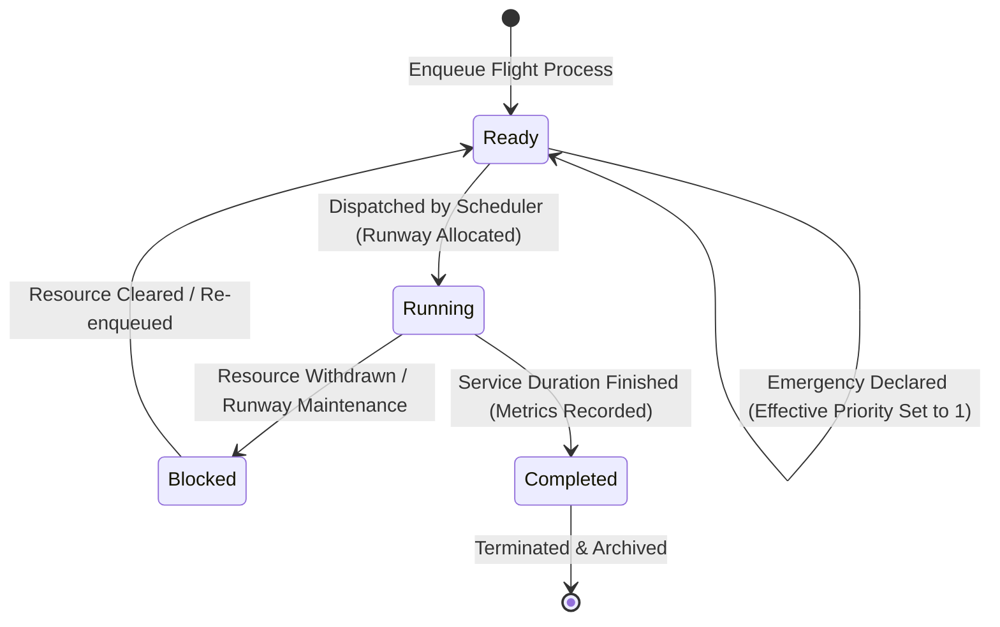

# Operating System Concepts Demonstration Guide — SmartATC

This technical guide details the exact procedures for demonstrating the core Operating System concepts implemented in SmartATC during the project evaluation.

---

## 1. Operating System Concepts Overview

The SmartATC architecture models seven fundamental Operating System principles:

1. **Process Representation & Process Control Block (PCB)**
2. **Process Lifecycle States & State Machine**
3. **Non-Preemptive Priority CPU Scheduling Simulation**
4. **Dynamic Emergency Priority Escalation**
5. **Starvation & Priority Aging**
6. **Critical Sections & Mutual Exclusion**
7. **Multi-threaded Concurrency & Thread Synchronization**

---

## 2. Concept A: Process Creation & The Process Control Block (PCB)

### 2.1 Theoretical Explanation for the Examiner
In an operating system, a process is an active program in execution represented in the kernel by a **Process Control Block (PCB)**. In SmartATC:
- An air traffic flight operation is represented as a simulated OS process (`Models::Process`).
- The PCB maintains all scheduling, identity, priority, and timing state.
- The application runs entirely in user-space C++ and simulates OS scheduling algorithms; it does not alter the host kernel.

### 2.2 PCB Attributes in Source Code (`src/models/Process.h`)

| PCB Field | Type | OS Concept Equivalent | Description & Simulation Role |
|:---|:---|:---|:---|
| `flightId` | `int` | **Process Identifier (PID)** | Unique integer identifying the task (maps to `flights.flight_id`). |
| `id` / `queueId` | `int` | **Queue Node ID** | Primary key linking the PCB to the persistent `scheduling_queue` table. |
| `state` | `ProcessState` | **Process State** | Lifecycle state: `New`, `Ready`, `Running`, `Blocked`, `Completed`. |
| `basePriority` | `int` | **Static Priority** | Inherent priority (1 = Highest ... 5 = Lowest), copied from flight record. |
| `effectivePriority` | `int` | **Dynamic Priority** | Schedulable priority adjusted dynamically by aging or emergency overrides. |
| `arrivalTime` | `QDateTime` | **Arrival Timestamp ($AT$)** | Timestamp when the process entered the runnable pool. |
| `readySince` | `QDateTime` | **Continuous Ready Start** | Timestamp when process entered current continuous `Ready` state (for aging). |
| `agingLevel` | `int` | **Aging Counter** | Total completed aging intervals accrued in `Ready` state. |
| `serviceTime` | `int` | **Service Duration / Burst ($BT$)** | Number of seconds the process requires exclusive allocation of a runway (default: 60s). |
| `waitingTime` | `int` | **Waiting Time ($WT$)** | Computed seconds spent waiting in the ready queue: $WT = TAT - BT$. |
| `turnaroundTime` | `int` | **Turnaround Time ($TAT$)** | Total elapsed seconds from arrival to completion: $TAT = CT - AT$. |
| `completionTime` | `QDateTime` | **Completion Time ($CT$)** | Wall-clock timestamp when process finished execution and released the runway. |

---

## 3. Concept B: Process States & Ready Queue Transitions

### 3.1 State Transition Lifecycle
SmartATC strictly enforces a discrete state machine for all processes:



### 3.2 In-Memory Thread-Safe Ready Queue (`ReadyQueue`)
- Implemented in `src/scheduler/ReadyQueue.h` as an in-memory queue protected by `QMutex`.
- Provides duplicate-PID prevention: attempting to enqueue a process whose `flightId` is already present is safely rejected.
- Enforces state validity: only processes with `state == ProcessState::Ready` can reside in the queue.

---

## 4. Concept C: Non-Preemptive Priority Scheduling

### 4.1 Scheduling Algorithm Rules
SmartATC implements **Non-Preemptive Priority Scheduling**:
1. **Priority Scale:** 1 to 5, where:
   - **`1` = Highest Priority**
   - **`5` = Lowest Priority**
2. **Precedence:** Lower numerical value denotes higher priority ($1 > 2 > 3 > 4 > 5$).
3. **Deterministic Selection:** `Scheduler::selectNextProcess()` evaluates all eligible processes in `Ready` state using a strict 3-tier comparator:
   - **Tier 1:** Lowest numerical `effectivePriority` (`effectivePriority ASC`).
   - **Tier 2:** Earlier arrival time (`arrivalTime ASC` / First-Come, First-Served).
   - **Tier 3:** Smaller flight ID (`flightId ASC` / Stable PID).
4. **Non-Preemptive Execution:** Once a process transitions to `Running`, it retains exclusive occupancy of the allocated runway for its full service duration (`serviceTime`). Newly arriving higher-priority processes do NOT evict or preempt the running aircraft.

### 4.2 Worked Scheduling Demonstration Example

Consider four queued processes competing for single runway dispatch:

| Process / Flight | Arrival Time ($AT$) | Service Time ($BT$) | Base Priority | Effective Priority | Scheduler Decision |
|:---|:---:|:---:|:---:|:---:|:---|
| **P1 (`AI-101`)** | $t = 0\text{s}$ | 40s | 3 | 3 | Dispatched at $t=0\text{s}$. Completes at $t=40\text{s}$. |
| **P2 (`6E-202`)** | $t = 0\text{s}$ | 30s | 4 | 4 | Priority tie with P1 broken by lower priority number (3 < 4). Waits in queue. |
| **P3 (`SG-404`)** | $t = 5\text{s}$ | 35s | 2 | 2 | Arrives at $t=5\text{s}$ with Priority 2. P1 is running, so non-preemption holds; P3 waits at head of queue. |
| **P4 (`UK-505`)** | $t = 10\text{s}$ | 25s | 5 | 5 | Enters tail of queue. |

#### Execution Chronology & Metric Computation:
1. **$t = 0\text{s}$:** P1 dispatched to `Running`. P2 waits in `Ready`.
2. **$t = 5\text{s}$:** P3 arrives with Priority 2. Placed ahead of P2 in queue. Non-preemption rule ensures P1 continues.
3. **$t = 40\text{s}$:** P1 completes ($CT = 40\text{s}$, $TAT = 40 - 0 = 40\text{s}$, $WT = 40 - 40 = 0\text{s}$).  
   Scheduler selects P3 (Priority 2 vs P2's Priority 4). P3 dispatched.
4. **$t = 75\text{s}$:** P3 completes ($CT = 75\text{s}$, $TAT = 75 - 5 = 70\text{s}$, $WT = 70 - 35 = 35\text{s}$).  
   Scheduler selects P2 (Priority 4 vs P4's Priority 5). P2 dispatched.
5. **$t = 105\text{s}$:** P2 completes ($CT = 105\text{s}$, $TAT = 105 - 0 = 105\text{s}$, $WT = 105 - 30 = 75\text{s}$).  
   Scheduler selects P4. P4 dispatched.
6. **$t = 130\text{s}$:** P4 completes ($CT = 130\text{s}$, $TAT = 130 - 10 = 120\text{s}$, $WT = 120 - 25 = 95\text{s}$).

$$\overline{TAT} = \frac{40 + 70 + 105 + 120}{4} = \mathbf{83.75\text{s}}, \quad \overline{WT} = \frac{0 + 35 + 75 + 95}{4} = \mathbf{51.25\text{s}}$$

---

## 5. Concept D: Dynamic Emergency Priority Handling

### 5.1 Emergency Mechanism
When a flight declares an in-flight emergency (e.g., fuel distress, hydraulic leak):
1. **Immediate Escalation:** The ATC controller toggles emergency in `FlightsView` or calls `declareFlightEmergency(flightId, true)`.
2. **Effective Priority Override:**
   $$\text{effectivePriority} = 1 \quad (\text{Highest Scheduling Priority})$$
3. **Preservation of Base Priority:** `basePriority` is strictly preserved (e.g., remains 5).
4. **Queue Re-evaluation:** `ReadyQueue` reorders immediately, moving the emergency process to the head of the queue.
5. **Non-Preemptive Respect:** If another process is currently `Running` on the runway, it is not preempted. The emergency process is selected for the very next allocation.
6. **Emergency Resolution:** When emergency status is cleared (`setEmergency(false)`), effective priority is restored to its aging-adjusted level:
   $$\text{effectivePriority} = \max(1, \text{basePriority} - \text{agingLevel})$$

---

## 6. Concept E: Priority Aging & Starvation Elimination

### 6.1 The Starvation Problem
In static priority scheduling, if high-priority processes (Priority 1 and 2) continuously enter the ready queue, lower-priority processes (Priority 4 and 5) may wait indefinitely. This is known as **starvation**.

### 6.2 The Aging Formulation
The `AgingEngine` solves starvation by continuously tracking waiting time in user space:
- **Eligible State:** Strictly applies to processes in `ProcessState::Ready`.
- **Elapsed Duration:** Computed as: $\Delta t = t_{\text{now}} - \text{readySince}$.
- **Aging Intervals Accrued:**
  $$\text{agingLevel} = \min\left(255, \left\lfloor \frac{t_{\text{now}} - \text{readySince}}{T_{\text{aging}}} \right\rfloor\right)$$
- **Effective Priority Promotion:**
  $$\text{effectivePriority} = \max(1, \text{basePriority} - \text{agingLevel})$$
- **Boundary Invariant:** Numerical priority value decrements towards **1** (highest priority). It cannot decrement below 1.
- **Configurable Demonstration Interval:** While real-world operations use 30–60 second intervals, the GUI spinbox allows setting a shorter interval (e.g., 5 seconds) to demonstrate aging live during the examination without changing code.

---

## 7. Concept F: Starvation Demonstration Module (Day 18 Tab)

The **Starvation Demonstration** tab in `SchedulingView` executes a reproducible, controlled scenario comparing two workloads side-by-side:

### 7.1 Track 1: Priority Scheduling Without Aging
- Initializes a low-priority cargo flight (Priority 4).
- Continuously introduces higher-priority commercial arrivals (Priority 2).
- **Result:** The low-priority flight is repeatedly bypassed. Its waiting time escalates continuously, demonstrating starvation risk under sustained high traffic.

### 7.2 Track 2: Priority Scheduling With Aging
- Executes the identical arrival pattern, but activates the `AgingEngine`.
- As waiting time accumulates, the low-priority flight's effective priority improves:
  $$\text{Priority } 4 \to 3 \to 2 \to 1$$
- Once it reaches Priority 1 or breaks a tie, it is dispatched to the runway.
- **Result:** Waiting time is strictly bounded, proving the effectiveness of priority aging in eliminating starvation.

---

## 8. Concept G: Critical Sections, Mutual Exclusion & Multithreading

### 8.1 The Runway as an Exclusive Shared Resource
A physical runway cannot be shared simultaneously. If two aircraft attempt to occupy the same runway at the same time, a race condition occurs. The runway is therefore a **critical section**.

### 8.2 In-Memory Mutual Exclusion (`std::mutex`)
In `src/resource/ResourceManager.h`:
- Runway state transitions are protected by `std::mutex m_resourceMutex`.
- Mutual exclusion is enforced via the RAII construct `ResourceManager::ScopedResourceLock`.
- When an execution thread acquires the lock, all other competing threads are blocked until the lock leaves scope and releases the mutex.

```cpp
// RAII Critical Section Protection in ResourceManager
{
    std::unique_lock<std::mutex> lock(m_resourceMutex);
    // CRITICAL SECTION START
    if (runway.status == RunwayStatus::Available) {
        runway.status = RunwayStatus::Occupied;
        runway.currentFlightId = flightId;
    }
    // CRITICAL SECTION END (lock automatically released upon destruction)
}
```

### 8.3 Multithreading Demonstration (`ConcurrentAllocationDemo`)
Located in `RunwaysView` under the "Concurrent Contention Demo" panel:
1. Spawns $N$ concurrent C++ threads (`std::thread`, default 3 or 4) representing separate aircraft.
2. Synchronizes all threads on a `std::condition_variable` start barrier so they attempt allocation at the exact same microsecond.
3. **Observation:**
   - Exactly **one thread** enters the critical section and succeeds in acquiring the runway.
   - All other threads are safely rejected with conflict notifications.
   - Threads join safely without memory leaks or race conditions (`join()`).
   - Demonstrates true C++ multi-threading, mutual exclusion, and thread synchronization.
