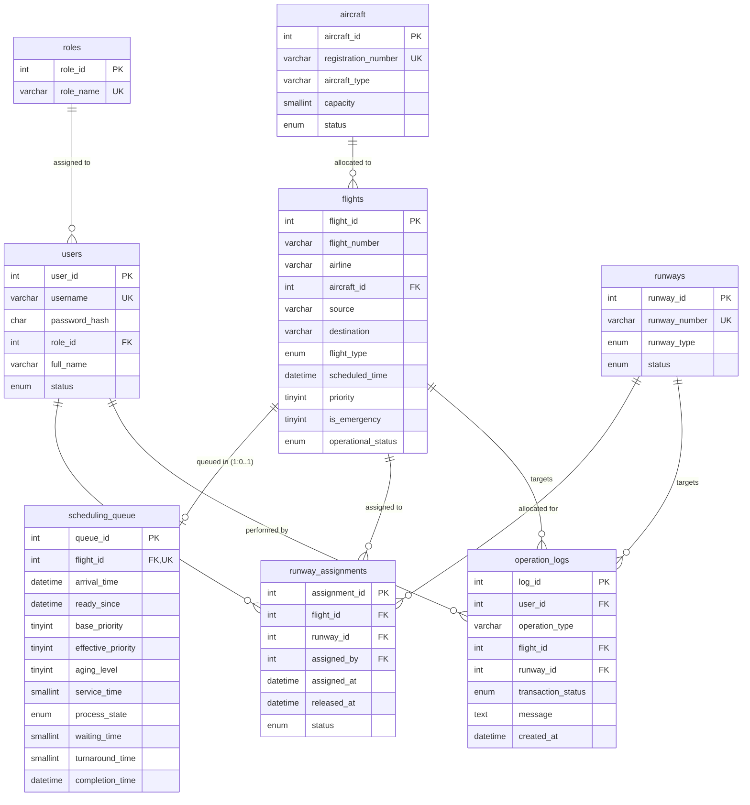

# SmartATC — Database Management System (DBMS) Viva Preparation Guide

## 1. Relational Database Concepts & Fundamentals

### 1.1 What is a DBMS?
A **Database Management System (DBMS)** is specialized software that provides an interface between end-users or application programs and the stored database. It manages data definition, storage, querying, indexing, access control, transaction execution, concurrency, and crash recovery.

### 1.2 Why MySQL Server (InnoDB Storage Engine)?
SmartATC utilizes **MySQL Server 8.0** with the default **InnoDB** storage engine because:
1. **Full ACID Compliance:** InnoDB provides write-ahead logging (redo log) and undo logs for atomic multi-statement transactions and automatic crash recovery.
2. **Row-Level Pessimistic Locking:** Unlike older table-locking engines (MyISAM), InnoDB supports fine-grained row-level exclusive locks (`SELECT ... FOR UPDATE`), essential for high-concurrency resource management.
3. **Strict Referential Integrity:** InnoDB enforces foreign key constraints (`ON DELETE RESTRICT` / `CASCADE` / `SET NULL`), preventing orphaned records across related entities.
4. **Standard SQL & CHECK Constraints:** Full support for SQL-92/2003 standards, including `CHECK` constraints on priority and capacity.

---

## 2. Relational Schema Architecture (The Eight Tables)

The SmartATC database (`smartatc`) consists of **exactly eight normalized tables** defined in `sql/schema.sql`:



---

## 3. Detailed Specification of the Eight Tables

### 1. `roles` (System Role Definitions)
- **Purpose:** Stores the defined application access tiers.
- **Primary Key:** `role_id` (`INT AUTO_INCREMENT`)
- **Key Columns:** `role_name` (`VARCHAR(50) UNIQUE NOT NULL`)
- **Relationships:** Parent to `users.role_id` (1:N).
- **Why Required:** Normalizes roles away from user accounts, preventing update anomalies and enabling dynamic permission lookups.

### 2. `users` (Operator Credentials & Accounts)
- **Purpose:** Stores authenticated user accounts for system access.
- **Primary Key:** `user_id` (`INT AUTO_INCREMENT`)
- **Foreign Keys:** `role_id` references `roles(role_id)` (`ON DELETE RESTRICT`)
- **Key Columns:** `username` (`VARCHAR(50) UNIQUE NOT NULL`), `password_hash` (`CHAR(64) NOT NULL`), `full_name` (`VARCHAR(100)`), `status` (`ENUM('Active','Inactive')`)
- **Relationships:** Child of `roles`, parent to `runway_assignments` (`assigned_by`) and `operation_logs` (`user_id`).
- **Why Required:** Enforces Role-Based Access Control and tracks human accountability in operation logs.

### 3. `aircraft` (Physical Fleet Registry)
- **Purpose:** Catalogs physical airplanes available to airlines.
- **Primary Key:** `aircraft_id` (`INT AUTO_INCREMENT`)
- **Key Columns:** `registration_number` (`VARCHAR(20) UNIQUE NOT NULL` e.g. `VT-AT1`), `aircraft_type` (`VARCHAR(100)`), `capacity` (`SMALLINT UNSIGNED`), `status` (`ENUM('Active','Maintenance','Retired')`)
- **Constraints:** `chk_aircraft_capacity` (`CHECK (capacity > 0)`)
- **Relationships:** Parent to `flights.aircraft_id` (1:N).
- **Why Required:** Separates the physical aircraft asset from individual flight schedules, enabling fleet tracking and wake turbulence calculations.

### 4. `flights` (Scheduled Flight Operations)
- **Purpose:** Core domain entity representing commercial flight journeys.
- **Primary Key:** `flight_id` (`INT AUTO_INCREMENT`)
- **Foreign Keys:** `aircraft_id` references `aircraft(aircraft_id)` (`ON DELETE SET NULL`)
- **Key Columns:** `flight_number` (`VARCHAR(10) NOT NULL`), `airline` (`VARCHAR(100)`), `source`, `destination`, `flight_type` (`ENUM('Arrival','Departure')`), `scheduled_time` (`DATETIME`), `priority` (`TINYINT UNSIGNED DEFAULT 3`), `is_emergency` (`TINYINT(1) DEFAULT 0`), `operational_status` (`ENUM('Scheduled','Taxiing','Cleared','Landed','Departed','Cancelled')`)
- **Constraints:** `chk_flights_priority` (`CHECK (priority BETWEEN 1 AND 5)`)
- **Relationships:** Child of `aircraft`, parent to `scheduling_queue`, `runway_assignments`, and `operation_logs`.
- **Why Required:** Manages flight metadata, schedules, operational status, and initial base priority.

### 5. `runways` (Airport Runway Infrastructure)
- **Purpose:** Models physical runways at the airport.
- **Primary Key:** `runway_id` (`INT AUTO_INCREMENT`)
- **Key Columns:** `runway_number` (`VARCHAR(10) UNIQUE NOT NULL` e.g. `09L`, `09R`, `27`), `runway_type` (`ENUM('Landing','Takeoff','Both')`), `status` (`ENUM('Available','Occupied','Maintenance')`)
- **Relationships:** Parent to `runway_assignments` and `operation_logs`.
- **Why Required:** Models shared physical resources; status column acts as the transactional lock target in MySQL transactions.

### 6. `scheduling_queue` (OS Process Simulation Telemetry)
- **Purpose:** Stores the Process Control Block state for schedulable flights.
- **Primary Key:** `queue_id` (`INT AUTO_INCREMENT`)
- **Foreign Keys:** `flight_id` references `flights(flight_id)` (`ON DELETE CASCADE`)
- **Unique Constraint:** `uq_sq_flight_id` on `flight_id` enforces a strict **1:0..1 relationship** (a flight cannot have multiple simultaneous queue records).
- **Key Columns:** `arrival_time`, `ready_since`, `base_priority`, `effective_priority`, `aging_level`, `service_time`, `process_state` (`ENUM('Ready','Running','Completed','Blocked')`), `waiting_time`, `turnaround_time`, `completion_time`
- **Constraints:** `chk_sq_base_priority`, `chk_sq_effective_priority`, `chk_sq_service_time`
- **Why Required:** Separates dynamic operating system scheduling telemetry from static flight metadata, satisfying Second Normal Form (2NF).

### 7. `runway_assignments` (Active Resource Allocation Ledger)
- **Purpose:** Persistent historical and active ledger of runway usage.
- **Primary Key:** `assignment_id` (`INT AUTO_INCREMENT`)
- **Foreign Keys:** `flight_id` references `flights(flight_id)` (`ON DELETE RESTRICT`), `runway_id` references `runways(runway_id)` (`ON DELETE RESTRICT`), `assigned_by` references `users(user_id)` (`ON DELETE SET NULL`)
- **Key Columns:** `assigned_at` (`DATETIME`), `released_at` (`DATETIME NULL`), `status` (`ENUM('Active','Released','Cancelled')`)
- **Relationships:** Intersection entity binding `flights`, `runways`, and `users`.
- **Why Required:** Resolves many-to-many relationship between flights and runways over time while enforcing single active occupancy.

### 8. `operation_logs` (Immutable System Audit Trail)
- **Purpose:** Append-only journal of all critical system actions, transactions, and state transitions.
- **Primary Key:** `log_id` (`INT AUTO_INCREMENT`)
- **Foreign Keys:** `user_id` (`ON DELETE SET NULL`), `flight_id` (`ON DELETE SET NULL`), `runway_id` (`ON DELETE SET NULL`)
- **Key Columns:** `operation_type` (`VARCHAR(50)` e.g. `LOGIN`, `RUNWAY_ASSIGN`, `EMERGENCY_DECLARED`), `transaction_status` (`ENUM('Committed','Rolled Back','N/A')`), `message` (`TEXT`), `created_at` (`DATETIME`)
- **Why Required:** Essential for DBMS audit verification, compliance tracking, and post-mortem failure analysis.

---

## 4. Normalization Analysis (1NF, 2NF, 3NF)

SmartATC is designed in **Third Normal Form (3NF)**:

### 1. First Normal Form (1NF)
- **Requirement:** Every column contains atomic (indivisible) values; no repeating groups or multi-valued arrays.
- **SmartATC Compliance:** In `flights`, `source` and `destination` are single scalar strings, not combined into a comma-separated column. In `runways`, operations (`Landing`, `Takeoff`, `Both`) are managed as distinct enums.

### 2. Second Normal Form (2NF)
- **Requirement:** Table is in 1NF, and every non-key attribute is fully functionally dependent on the primary key (no partial dependencies on composite keys).
- **SmartATC Compliance:** All tables use synthetic surrogate primary keys (`flight_id`, `runway_id`). Scheduling attributes (`service_time`, `waiting_time`, `turnaround_time`, `process_state`) depend on the flight *only when it enters the queue*. By placing them in `scheduling_queue` rather than `flights`, partial dependencies and sparse NULL values are avoided.

### 3. Third Normal Form (3NF)
- **Requirement:** Table is in 2NF, and no non-key attribute is transitively dependent on the primary key ($X \to Y \to Z$).
- **SmartATC Compliance:** In `users`, we store `role_id` referencing `roles`. We do not store `role_name` or permissions directly in `users`, avoiding transitive dependency: $\text{user\_id} \to \text{role\_id} \to \text{role\_name}$. Similarly, `aircraft_type` and `capacity` reside in `aircraft`, not duplicated inside `flights`.

---

## 5. Security & Query Execution

### 5.1 Parameterized Queries & Prepared Statements
All SQL interactions in SmartATC use prepared statements via Qt's `QSqlQuery::prepare()` and `QSqlQuery::bindValue()`:
```cpp
QSqlQuery q(db);
q.prepare("UPDATE runways SET status = :status WHERE runway_id = :rid;");
q.bindValue(":status", "Occupied");
q.bindValue(":rid", runwayId);
q.exec();
```

### 5.2 Prevention of SQL Injection (OWASP A03)
- **How Prepared Statements Stop Injection:** In string concatenation (`"SELECT * FROM users WHERE name = '" + input + "'"`), an attacker can supply `' OR '1'='1` to alter query structure.
- In prepared statements, the database engine compiles the SQL command syntax **before** binding data values. Input parameters are treated strictly as literal data values, making SQL injection syntactically impossible regardless of characters contained in user input.
