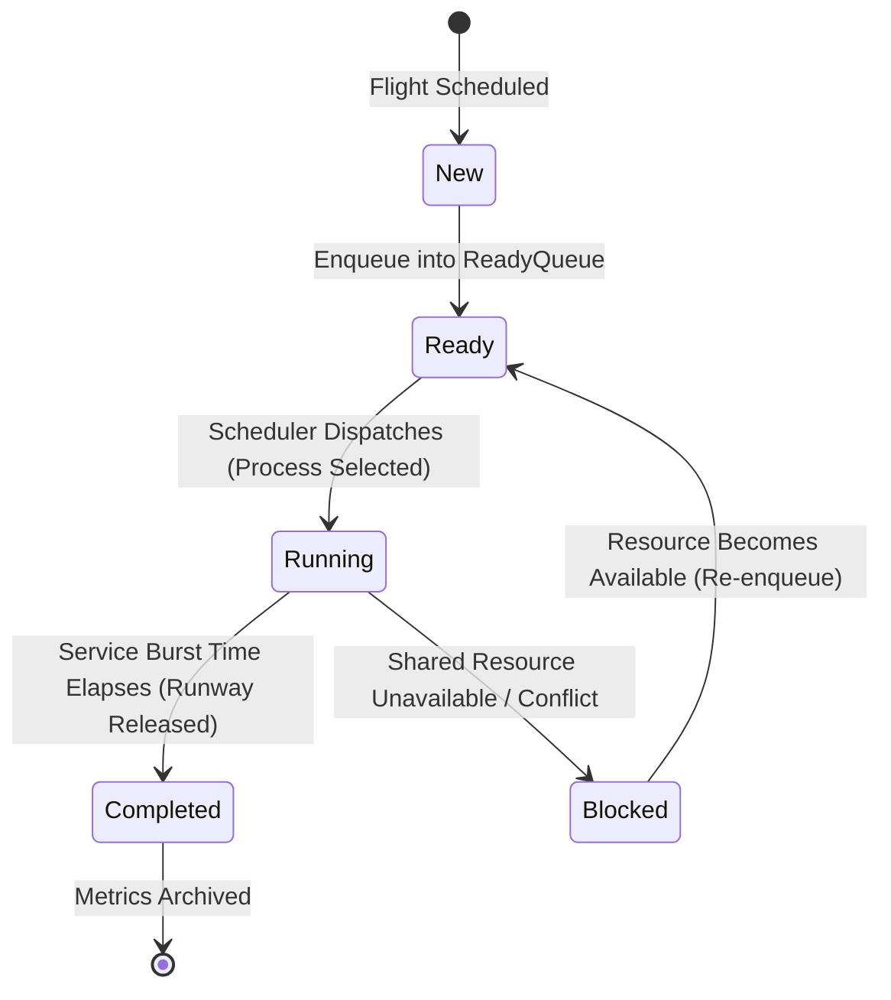

# SmartATC — Operating System Concepts Viva Preparation Guide

## 1. Process Management & Process Control Block (PCB)

### 1.1 What is a Process?
In computer science, a **Process** is an instance of a program in execution. It represents the basic unit of work in an operating system, encompassing program instructions, memory address space, CPU registers, execution state, and system resources.

### 1.2 Why is a Flight Represented as a Simulated Process?
In airport air traffic management, each arriving or departing flight constitutes an independent, schedulable unit of work that contends for scarce physical resources (runways, gates, taxiways). By modeling each flight as a simulated process:
- The flight's arrival time mirrors an **OS Process Arrival Time**.
- The runway occupancy time (touchdown, rollout, taxiing) mirrors **CPU Burst Time / Service Time**.
- Flight urgency (emergency, VIP, scheduled, delayed) mirrors **Process Priority**.
- The flight's operational progression mirrors the **OS Process Lifecycle State Machine**.

### 1.3 What is a Process Control Block (PCB)?
A **Process Control Block (PCB)** is the fundamental operating system data structure used to maintain all information regarding an active process. 

In SmartATC, the PCB is implemented as the C++ structure `Models::Process` (`src/models/Process.h`). It encapsulates:
```cpp
struct Process {
    int             id                 = 0;  // Database queue ID
    int             flightId           = 0;  // Unique Process ID (PID)
    QDateTime       arrivalTime;             // When process entered the system
    int             basePriority       = 3;  // Static priority (1=highest ... 5=lowest)
    int             effectivePriority  = 3;  // Dynamic priority (used by scheduler)
    QDateTime       readySince;              // Start of continuous Ready state (for aging)
    int             agingLevel         = 0;  // Accrued aging intervals
    bool            isEmergency        = false; // In-flight distress flag
    int             serviceTime        = 60; // Burst duration in seconds (default 60s)
    ProcessState    state;                   // Current execution state
    int             waitingTime        = -1; // Cumulative Ready waiting duration
    int             turnaroundTime     = -1; // Total elapsed lifetime
    QDateTime       completionTime;          // Timestamp when process completed
};
```

### 1.4 Real OS Process vs. SmartATC Simulated Process
| Attribute | Real OS Process (e.g. Linux task_struct) | SmartATC Simulated Process (`Models::Process`) |
|---|---|---|
| **Execution Context** | Native hardware CPU registers, virtual memory page tables, kernel stack. | In-memory C++ struct representing airport workload metadata. |
| **Scheduler Domain** | Kernel space, hardware timer interrupts, assembly context switches. | User space application layer, Qt event loop, discrete simulation clock. |
| **Resource Managed** | CPU instruction cycles, physical RAM pages. | Physical airport runways, landing and takeoff operational time slots. |
| **Memory Isolation** | MMU hardware memory protection per virtual address space. | Shared heap objects within single application memory, synchronized via mutexes. |

---

## 2. Process Lifecycle States & State Transitions

### 2.1 The Actual C++ Process States
In SmartATC (`src/models/Process.h`), process execution is governed strictly by the `ProcessState` enum:
1. **`New`:** The initial conceptual state when an aircraft request is registered before entering the runnable scheduling queue.
2. **`Ready`:** The process has arrived, is runnable, and is placed in the `ReadyQueue` awaiting resource dispatch.
3. **`Running`:** The process has been selected by the scheduler and is currently executing its runway allocation maneuver.
4. **`Blocked`:** The process is temporarily waiting for an external condition or shared resource to become available (e.g., runway in maintenance or resource locked).
5. **`Completed`:** The process has finished runway usage; operational service duration has elapsed, and final metrics (TAT, WT) are computed.

> [!NOTE]
> **State Model Terminology:** SmartATC uses strictly `New`, `Ready`, `Running`, `Blocked`, and `Completed`. We do not use invented or mismatched textbook terms like `Waiting` or `Terminated`.

### 2.2 Supported Process State Transitions


### 2.3 Database Mapping in MySQL
In the relational database, table `scheduling_queue` defines:
```sql
process_state ENUM('Ready', 'Running', 'Completed', 'Blocked') NOT NULL DEFAULT 'Ready'
```
- **`ProcessState::New`:** Maps to `'Ready'` upon persistent database record creation.
- **`ProcessState::Ready`:** Maps directly to `'Ready'`.
- **`ProcessState::Running`:** Maps directly to `'Running'`.
- **`ProcessState::Blocked`:** Maps directly to `'Blocked'`.
- **`ProcessState::Completed`:** Maps directly to `'Completed'`.

---

## 3. Scheduling Architecture & Policy

### 3.1 What is CPU/Process Scheduling?
Scheduling is the operating system mechanism that determines which runnable process from the ready queue is allocated hardware execution resources when resources become free, according to predefined algorithms and policies.

### 3.2 What is a Ready Queue?
The **Ready Queue** (`SchedulerComponents::ReadyQueue`) is a priority queue data structure holding all processes currently in the `Ready` state awaiting dispatch. In SmartATC, `ReadyQueue` maintains safe in-memory process pointers, sorted dynamically by effective priority.

### 3.3 Scheduling Policy: Non-Preemptive Priority Scheduling
SmartATC implements **Non-Preemptive Priority Scheduling**:
- **Why Priority Scheduling?** Airport traffic operates on strict operational urgency: emergency distress calls, international heavy long-haul arrivals, scheduled passenger services, and regional freighters have inherently distinct operational requirements.
- **Why Non-Preemptive?** In aviation physical dynamics, once a heavy commercial airliner enters the final touchdown flare, rollout, or high-speed takeoff roll, abruptly aborting or preempting the aircraft introduces severe crash hazards. Therefore, once allocated, the process holds the runway resource non-preemptively until its service burst duration (`serviceTime`) is safely concluded.
- **Why Smaller Priority Number Represents Higher Priority?** Following standard UNIX/Linux operating system conventions (`nice` values and POSIX realtime priorities), **Priority 1 represents the Highest Priority** (Emergency/VIP), while **Priority 5 represents the Lowest Priority** (Routine domestic/cargo).

### 3.4 Deterministic Tie-Breaking Rules
When multiple processes share the same effective priority, ties are resolved deterministically using a strict three-tier comparator in `ReadyQueue`:
1. **Effective Priority ASC:** Smaller numerical value wins ($1 < 2 < 3 < 4 < 5$).
2. **Arrival Time ASC:** If effective priorities are equal, the process with the earlier `arrivalTime` wins (First-Come, First-Served / FCFS tie-breaker).
3. **Flight ID ASC:** If arrival timestamps are identical, the smaller integer PID wins (stable deterministic ordering).

$$\text{Sorting Predicate: } (P_{\text{eff1}} < P_{\text{eff2}}) \lor (P_{\text{eff1}} == P_{\text{eff2}} \land t_{\text{arr1}} < t_{\text{arr2}}) \lor (P_{\text{eff1}} == P_{\text{eff2}} \land t_{\text{arr1}} == t_{\text{arr2}} \land \text{id}_1 < \text{id}_2)$$

---

## 4. Dynamic Emergency Priority Escalation

### 4.1 How Emergency Status Modifies Effective Priority
When an in-flight emergency occurs (e.g. engine fire, fuel distress, cabin depressurization):
1. Air Traffic Control invokes `ApplicationService::declareEmergency(flightId)`.
2. The process flag `isEmergency` is set to `true`.
3. The process's `effectivePriority` is immediately overridden to **1** (highest possible priority).
4. `ReadyQueue::reorder()` is called: the distressed process instantly advances to the head of the `ReadyQueue` ahead of normal flights.

### 4.2 Preservation of Base Priority
> [!IMPORTANT]
> **Base Priority Invariant:**  
> Declaring an emergency does **NOT** alter the flight's permanent `basePriority`. A flight with base priority 3 elevated to effective priority 1 maintains its base priority 3. When the emergency status is cleared, the system cleanly restores `effectivePriority` to $\max(1, \text{basePriority} - \text{agingLevels})$.

### 4.3 Why Emergency Scheduling is NOT Preemption
In preemptive operating systems, declaring an emergency would immediately context-switch and evict the currently running process from the CPU. 

In SmartATC:
- The currently running aircraft **continues executing safely** on the runway until its burst completes.
- The emergency flight is placed at **Index 0 of the Ready Queue**.
- The emergency flight is guaranteed to be dispatched at the **very next scheduling opportunity**.

---

## 5. Priority Aging & Starvation Prevention

### 5.1 What is Starvation?
**Starvation** (or indefinite postponement) is a classic concurrency vulnerability in priority scheduling algorithms where low-priority processes (e.g., Priority 4 or 5) wait indefinitely in the Ready Queue because higher-priority processes (Priorities 1, 2, or 3) continuously arrive into the system.

### 5.2 What is Priority Aging?
**Priority Aging** is a dynamic operating system technique that gradually increases the priority of processes that have remained waiting in the ready queue for extended periods, guaranteeing that every runnable process will eventually reach the highest priority tier and be scheduled.

### 5.3 SmartATC Mathematical Aging Model
Aging is implemented via `SchedulerComponents::AgingEngine` (`src/scheduler/AgingEngine.cpp`).

- **Elapsed Waiting Time Calculation:** Continuous time spent waiting in `Ready` is computed from the process attribute `readySince`:
  $$\text{elapsedWaitingSeconds} = \text{readySince.secsTo}(now)$$
- **Default Aging Interval:** `AgingEngine::DEFAULT_INTERVAL_SECONDS = 30` seconds (configurable between 1s and 86,400s via `setIntervalSeconds()`).
- **Accrued Aging Levels:**
  $$\text{agingLevels} = \left\lfloor \frac{\text{elapsedWaitingSeconds}}{\text{configuredIntervalSeconds}} \right\rfloor$$
- **Effective Priority Calculation:**
  $$\text{effectivePriority} = \begin{cases} 
  1 & \text{if } \text{isEmergency} == \text{true} \\
  \max(1, \ \text{basePriority} - \text{agingLevels}) & \text{otherwise}
  \end{cases}$$

### 5.4 Idempotency & Realistic Boundary Constraints
- **Idempotent Evaluation:** Because `agingLevels` is computed directly from `readySince.secsTo(now)` rather than incrementing an accumulator variable on every timer tick, delayed timer events or timer restarts never cause skipped or duplicated aging levels.
- **Lower Priority Bound:** Effective priority can never drop below 1 ($\max(1, \dots)$).
- **Academic Limitation Note:** While aging prevents static starvation by ensuring a process reaches Priority 1, under an infinite flood of higher-priority emergency arrivals, queue latency will still expand. Aging guarantees bounded priority improvement, not an infinite processing capacity.

---

## 6. Scheduling Performance Metrics

When a process completes execution, `Process::calculateMetrics(completedAt)` computes standardized scheduling performance metrics:

1. **Arrival Time ($t_{\text{arr}}$):** Timestamp when the flight entered the ready queue.
2. **Burst / Service Time ($t_{\text{serv}}$):** Simulated runway occupancy duration in seconds (default 60s).
3. **Completion Time ($t_{\text{comp}}$):** Timestamp when the process transitions to `Completed`.
4. **Turnaround Time ($TAT$):** Total elapsed time from arrival to completion:
   $$TAT = t_{\text{comp}} - t_{\text{arr}}$$
   *(Requirement: $TAT \ge t_{\text{serv}}$)*
5. **Waiting Time ($WT$):** Total time spent waiting in the ready queue without service:
   $$WT = TAT - t_{\text{serv}}$$
   *(Requirement: $WT \ge 0$)*
6. **Average Turnaround Time ($\overline{TAT}$):**
   $$\overline{TAT} = \frac{1}{N} \sum_{i=1}^{N} TAT_i$$
7. **Average Waiting Time ($\overline{WT}$):**
   $$\overline{WT} = \frac{1}{N} \sum_{i=1}^{N} WT_i$$

All metrics are logged in `operation_logs` and aggregated live on the `DashboardView`.

---

## 7. Runway Resource Management & Concurrency Primitives

### 7.1 Runway as a Shared Resource (Not a CPU)
> [!IMPORTANT]
> **Core Conceptual Distinction:**  
> In operating systems, the CPU is a preemptible computational execution core. A runway in SmartATC is modeled as a **Shared Hardware Resource** (analogous to a non-shareable magnetic tape drive, disk sector, or shared memory region). Aircraft processes require exclusive possession of the runway resource for their operational service duration.

### 7.2 Critical Section & Mutual Exclusion
- **Critical Section:** A segment of code that accesses a shared resource that must not be concurrently executed by more than one thread of execution. In SmartATC, the Critical Section is the allocation logic in `ResourceManager::allocateRunway()` and `ApplicationService::allocateRunway()`.
- **Mutual Exclusion:** The requirement that one process/thread holds exclusive access to a shared resource, blocking all other processes from accessing the same resource simultaneously.

### 7.3 Concurrency Primitives in C++17
1. **`std::mutex`:** Mutual exclusion primitive used in `ResourceManager` (`m_resourceMutex`) to synchronize in-memory allocation states across concurrent worker threads.
2. **RAII Scoped Locking (`ResourceManager::ScopedResourceLock`):** Utilizes `std::unique_lock<std::mutex>` under Resource Acquisition Is Initialization (RAII). Locks the mutex upon instantiation and automatically releases it when leaving scope, preventing deadlocks during unexpected returns or exceptions.
3. **`std::thread`:** Used in `ConcurrentAllocationDemo` (`src/resource/ConcurrentAllocationDemo.cpp`) to spawn simultaneous threads representing competing flights attempting to acquire the same runway.
4. **`std::condition_variable`:** Used to coordinate thread wakeups and clean joins during multi-threaded simulation runs.

### 7.4 Prevention of Double Allocation
Two flights can never simultaneously occupy the same runway because:
1. **In-Memory Protection:** The allocation method enters a critical section guarded by `std::mutex`. The first thread checks availability, marks the runway reserved, and sets status to Occupied. The second thread unblocks, observes the Occupied status, and is safely rejected.
2. **Database Protection:** The database transaction issues `SELECT runway_number, status FROM runways WHERE runway_id = :id FOR UPDATE`, acquiring an exclusive row lock in MySQL InnoDB. The competing transaction is blocked at the database engine level until the first commits.
