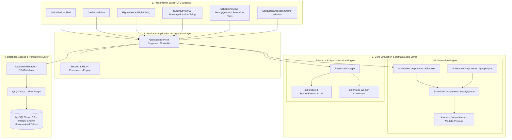

# SmartATC — Project Overview & Viva Defense Guide

## 1. Executive Summary & Project Introduction

**Project Title:** Smart Air Traffic Control Management System (SmartATC): Airport Runway Manager & Resource Allocation  
**Academic Degree:** Bachelor of Technology (B.Tech) in Computer Science & Engineering  
**Technology Stack:** C++17, Qt 6.11.2 Widgets, MySQL 8.0 (InnoDB), CMake 3.19+, Ninja, MinGW-w64 GCC 13.1.0  
**Simulation Setting:** Chhatrapati Shivaji Maharaj International Airport (BOM / VABB), Mumbai, India  

The **Smart Air Traffic Control Management System (SmartATC)** is an educational, production-structured desktop simulation application. It demonstrates the direct practical convergence of core **Operating System (OS)** principles and **Database Management System (DBMS)** principles by modeling real-world airport terminal operations.

> [!IMPORTANT]
> **Educational Simulation Disclaimer:**  
> SmartATC is strictly an academic simulation running in user space on the host operating system. It is designed to teach and demonstrate computer science paradigms. It **does not interface with physical radar, aircraft transponders, or certified aviation safety equipment**, nor does it implement a kernel-level hardware scheduler.

---

## 2. Problem Statement & Motivation

### 2.1 The Real-World Domain Problem
Commercial airport runways represent extreme physical bottleneck resources:
1. **Scarcity & Mutual Exclusion:** Runways cannot be simultaneously shared by multiple landing or departing aircraft without catastrophic failure.
2. **Dynamic Priorities & Emergencies:** In-flight distress (fuel exhaustion, engine flameout, medical crises) requires instantaneous priority escalation.
3. **Starvation Risk:** Steady incoming waves of high-priority international or VIP traffic can indefinitely postpone low-priority domestic, regional, or cargo flights.
4. **Data Integrity & Consistency:** Runway allocation involves updating runway statuses, flight states, operational assignments, and audit trails simultaneously; any partial failure causes dangerous state drift.

### 2.2 Pedagogical Motivation
Computer Science students frequently study Operating Systems and Database Systems as disconnected theoretical courses:
- Process scheduling algorithms (FCFS, SJF, Priority) are often studied on paper using arbitrary Gantt charts.
- Database transaction properties (ACID, row locking, commit/rollback) are practiced as isolated SQL terminal commands.

**SmartATC bridges this divide** by providing a tangible, real-time desktop application where:
- A **Flight** is modeled as a schedulable **OS Process** governed by a **Process Control Block (PCB)**.
- A **Runway** is modeled as a **Shared Hardware Resource** protected by a **Critical Section** (`std::mutex`).
- Air traffic prioritization is executed via a **Non-Preemptive Priority Scheduler** with dynamic **Priority Aging** to eliminate starvation.
- State changes are executed as multi-table **Pessimistic ACID Transactions** in **MySQL 8 (InnoDB)** using `SELECT ... FOR UPDATE` row locks.

---

## 3. Project Objectives & Scope

### 3.1 Core Objectives
1. **Process Management & Scheduling:** Implement simulated PCBs with full lifecycle states (`New`, `Ready`, `Running`, `Blocked`, `Completed`) and non-preemptive priority dispatching (Priority 1 = Highest to 5 = Lowest) with deterministic tie-breakers.
2. **Starvation Mitigation:** Engineer an idempotent, wall-clock **Aging Engine** dynamically reducing numerical priority values over elapsed waiting time in `Ready`.
3. **Hardware Mutual Exclusion:** Guard shared runways using RAII-wrapped `std::mutex` (`ScopedResourceLock`) and demonstrate race condition prevention under multi-threaded contention (`std::thread`).
4. **Relational ACID Transactions:** Enclose multi-statement allocation and release workflows in MySQL transactions with explicit pessimistic row locks, verifying atomic commit, rollback on failure, and durability across restarts.
5. **Role-Based Access Control:** Protect sensitive operational actions across three distinct authenticated roles: `Admin`, `ATC` (Air Traffic Controller), and `Airport Operator`.
6. **Data-Driven Monitoring:** Deliver a unified real-time dashboard reflecting live system telemetry without hardcoded or synthetic values.

### 3.2 System Boundaries & Scope
- **Included:** Desktop GUI client, in-memory OS scheduling simulation, multi-threaded contention demo, relational 3NF database schema, ACID transaction boundary management, automated regression suites (19 test suites).
- **Excluded:** Hardware radar transponder integration, radio frequency voice communications, flight dynamic aerodynamic equations, 3D airspace vectoring, distributed network clustering.

---

## 4. Architectural Flow & Layered Design

SmartATC is structured into a strictly decoupled 4-tier layered architecture:

### Purpose of Every Layer:
1. **Presentation Layer (`ui/`):** Native Qt 6 GUI utilizing event loops, models, signals, and slots. Captures operator input, renders real-time telemetry, and displays modal dialogs.
2. **Service Layer (`src/services/`):** `ApplicationService` serves as the centralized business logic façade. Validates inputs, authenticates sessions, checks RBAC permissions, coordinates scheduling with database transactions, and manages in-memory/database synchronization.
3. **OS Simulation & Resource Layer (`src/scheduler/`, `src/resource/`, `src/models/`):** Pure C++ domain logic modeling PCBs, sorting priority queues, executing aging timers, and guarding physical runway instances with `std::mutex`.
4. **Database Access Layer (`src/database/`):** `DatabaseManager` wraps Qt's `QSqlDatabase`. Connects via `QMYSQL`, parses `db.conf`, issues prepared SQL statements with parameter binding, and coordinates transaction boundaries (`transaction()`, `commit()`, `rollback()`).

---

## 5. Technology Stack Justification

| Technology | Selected Version | Academic & Architectural Justification |
|---|---|---|
| **C++17** | ISO/IEC 14882:2017 | Provides deterministic resource management via RAII, high-performance concurrency primitives (`std::mutex`, `std::unique_lock`, `std::thread`), strong type safety, and zero-overhead abstractions. |
| **Qt 6 Widgets** | Qt 6.11.2 (MinGW 64-bit) | Mature desktop UI framework providing cross-platform GUI components, thread-safe Signal/Slot communication mechanism, and integrated SQL abstractions (`QSqlDatabase`, `QSqlQuery`). |
| **MySQL Server** | MySQL 8.0.46 (Community) | Production-grade relational database engine. InnoDB provides robust multi-statement transactions, ACID compliance, crash recovery (redo/undo logs), and pessimistic row locking (`SELECT ... FOR UPDATE`). |
| **Qt SQL (QMYSQL)** | Qt 6 Plugin (`libmysql.dll`) | Native database driver compiling against MySQL C client libraries, enabling high-speed binary protocol database interaction and prepared query execution. |
| **CMake & Ninja** | CMake 3.19+ / Ninja 1.10+ | Fast, cross-platform build orchestration supporting automated MOC/UIC code generation and declarative test suite configuration. |
| **MinGW-w64 GCC** | GCC 13.1.0 (64-bit) | Modern C++17 compiler toolchain providing robust Windows native binary compilation and debugging support. |

---

## 6. Functional Modules Overview

1. **User Authentication & RBAC Module:**
   - Authenticates operators via SHA-256 hashed credentials against the `users` table.
   - Enforces least-privilege permissions across 3 roles: `Admin` (System Config), `ATC` (Air Traffic Operations), and `Airport Operator` (Ground & Maintenance).
2. **Flight & Fleet Administration Module:**
   - Maintains commercial aircraft records (`aircraft` table) with wake turbulence categories.
   - Tracks incoming and outgoing flights (`flights` table) through their operational lifecycle: `Scheduled` $\to$ `Taxiing` $\to$ `Cleared` $\to$ `Landed` / `Departed` / `Cancelled`.
3. **Runway Infrastructure Module:**
   - Manages physical runways (`runways` table) categorized by operation type (`Landing`, `Takeoff`, `Both`) and operational status (`Available`, `Occupied`, `Maintenance`).
4. **OS Process & Ready Queue Module:**
   - Translates flights into simulated PCBs (`Process` struct) with arrival timestamps and burst service durations.
   - Dispatches processes via a thread-safe `ReadyQueue` using Non-Preemptive Priority Scheduling.
5. **Emergency Handling & Priority Aging Module:**
   - Dynamic emergency escalation elevates distressed flights to Effective Priority 1 while preserving base priorities.
   - Background `AgingEngine` timer dynamically promotes waiting low-priority processes over elapsed intervals to eliminate starvation.
6. **Concurrency & Critical Section Module:**
   - Protects physical runways against race conditions using in-memory `std::mutex` and RAII `ScopedResourceLock`.
   - Simulates multi-threaded contention via `ConcurrentAllocationDemo`.
7. **DBMS Transaction & ACID Module:**
   - Groups multi-table allocations (`runways`, `runway_assignments`, `flights`, `operation_logs`) into atomic MySQL transactions.
   - Serializes concurrent database requests via pessimistic row locking (`SELECT ... FOR UPDATE`).
8. **System Dashboard & Telemetry Module:**
   - Centralized graphical dashboard providing real-time KPI metrics, runway utilization gauges, emergency flight alerts, and streaming audit trails.

---

## 7. Limitations & Future Scope

### 7.1 Current System Limitations
1. **Unsalted Password Hashing:** Passwords are currently hashed using unsalted SHA-256. While superior to plaintext, modern systems require adaptive salted hashing algorithms (Argon2id or bcrypt).
2. **Durability Scope:** Durability was verified via application restarts and MySQL commit flushes to disk; hardware-level sudden power-loss crash testing was not performed.
3. **Single Process Queue Record per Flight:** Database schema enforces a 1:0..1 unique relationship (`uq_sq_flight_id`), permitting only one active scheduling record per flight at a time.
4. **In-Memory Threading Scope:** Concurrency demonstration models worker threads within a single application process; multi-instance cross-process distributed synchronization relies entirely on MySQL row locks.

### 7.2 Future Enhancements
- **Preemptive Airspace Stacks:** Implement a preemptive scheduling tier for holding pattern airspace vectors prior to final runway approach.
- **Argon2id Password Upgrade:** Migrate `PasswordUtils` to modern salted Argon2id password hashing.
- **Multi-Airport Network Federation:** Scale database schema to model multiple interconnected regional airports with flight transit dependencies.
- **WebSocket Telemetry Stream:** Expose dashboard telemetry over WebSockets to support secondary remote radar displays.
